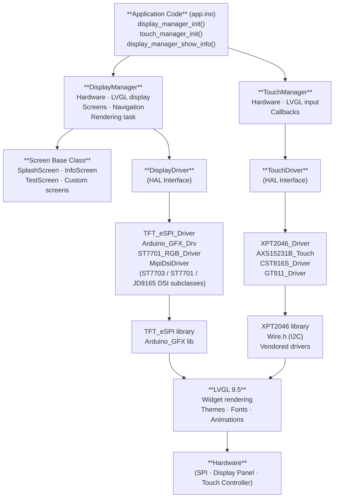
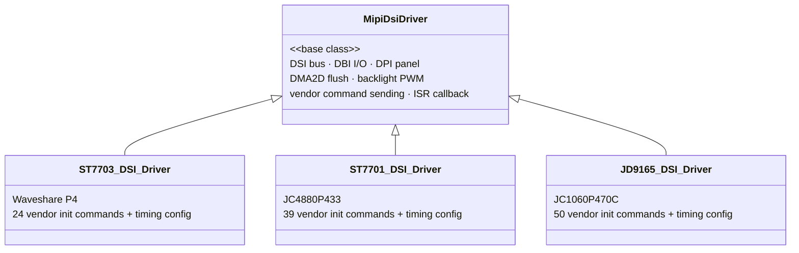
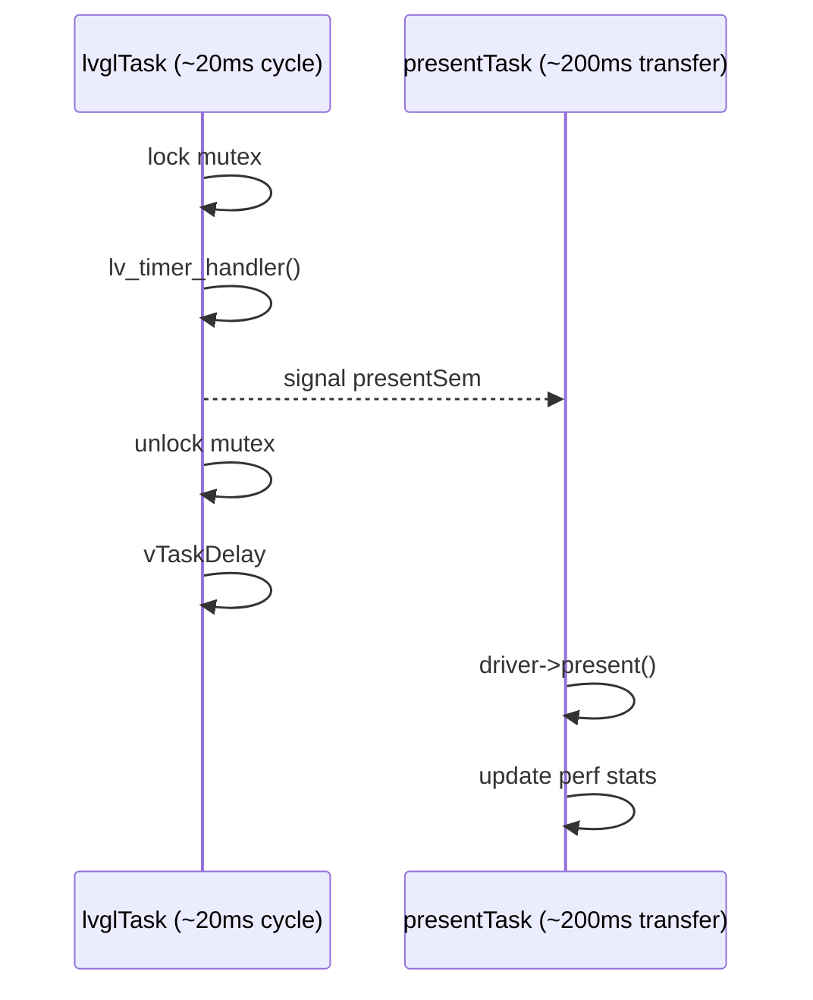
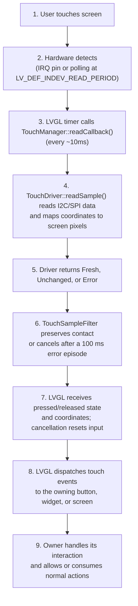
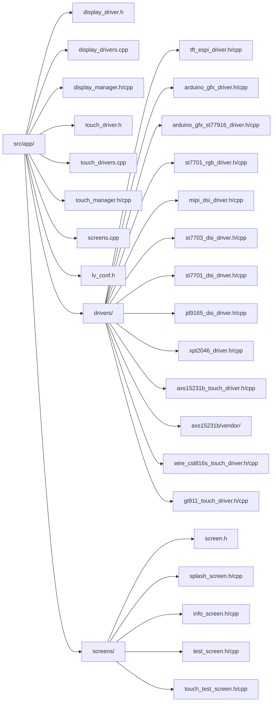
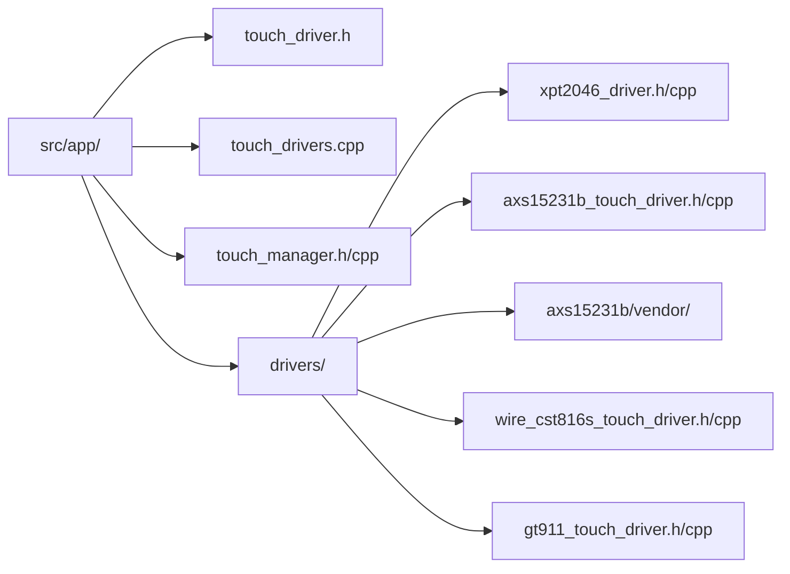

This document describes the display and touch subsystem architecture, design patterns, and extension points for adding new displays, touch controllers, and screens.

## Table of Contents

- [Overview](#overview)
- [Architecture Layers](#architecture-layers)
- [Display Driver HAL](#display-driver-hal)
- [Touch Driver HAL](#touch-driver-hal)
- [Screen Management](#screen-management)
- [Rendering System](#rendering-system)
- [Adding New Display Drivers](#adding-new-display-drivers)
- [Adding New Touch Drivers](#adding-new-touch-drivers)
- [Adding New Screens](#adding-new-screens)
- [Multi-Board Support](#multi-board-support)
- [Performance Considerations](#performance-considerations)

## Overview

The display and touch subsystem is built on four main pillars:

1. **Display HAL** - Isolates display hardware library specifics
2. **Touch HAL** - Isolates touch controller library specifics
3. **Screen Pattern** - Base class for creating reusable UI screens
4. **Manager Classes** - Centralized management of hardware, LVGL, and lifecycle

**Key Technologies:**
- **LVGL 9.5** - Embedded graphics library
- **TFT_eSPI** - Default display driver (supports ILI9341, ST7789, ST7735, etc.)
- **XPT2046_Touchscreen** - Resistive touch support
- **FreeRTOS** - Task-based continuous rendering

LVGL drawing currently uses the software renderer on ESP32-P4 as well as other
targets (`LV_USE_PPA=0`). LVGL 9.5.0 aligns intermediate-buffer addresses but
not their sizes to PPA cache-line requirements. Pattern fills amplify rejected
PPA operations into a serial error storm and severe rendering stalls. This
temporary mitigation leaves pattern rendering unchanged and may reduce P4
drawing performance. The MIPI-DSI driver's separate PPA rotation path retains
its aligned buffers and remains enabled.

Keep LVGL pinned to 9.5.0 until a released upgrade supports the stable
Arduino-ESP32 SDK: 9.6.0 fixes buffer-size alignment but its PPA cache code uses
an API absent from Arduino-ESP32 3.3.12's ESP-IDF 5.5.5. Re-enabling LVGL PPA
requires patterned-button and bar-track checks, rounded clipping, partial
redraws, repeated pad navigation, and a hardware soak test. The software-rendering
mitigation builds for `jc1060p470c-sd` and passed an initial user hardware check.
The LVGL allocator includes its SoC capability header directly so disabling PPA
does not disable PSRAM-first allocation or exhaust internal DMA-capable memory.

## Architecture Layers



## Display Driver HAL

### StopWatch AMOLED Bring-Up

`m5stack-stopwatch` uses a CO5300 adapter over the existing Arduino_GFX QSPI
transport, selected with `DISPLAY_DRIVER_ARDUINO_GFX_CO5300`. It does not need
M5Unified/M5GFX as runtime dependencies. The shared Wire bus on SDA47/SCL48
must be initialized and locked before M5PM1/M5IOE1 power/reset operations,
which precede display initialization. After enabling the PMIC rails, firmware
polls the expander every 10 ms for up to 2 seconds. On timeout, a failure-only
diagnostic compares address acknowledgments and two-byte UID register reads
at both `0x4f` and `0x6f`. Each address receives a wake transaction, a 10 ms
wait, a 100 kHz attempt, another 100 kHz attempt after 800 ms, then a 400 kHz
attempt. The shared bus returns to 100 kHz before PMIC diagnostics. These
checks add about 1.66 seconds plus transaction time and leave peripherals
unavailable even if a diagnostic read succeeds. Repeated cold boots confirmed
display, touch, and audible audio operation with the extended timeout; one
observed boot discovered the expander after 250 ms, beyond the previous
200 ms limit. The failure-only diagnostic was not exercised on those boots.
Expander IO8 powers the display; IO5
resets it and IO4 resets touch. They are not ordinary GPIOs.

The logical canvas is the documented 466 × 466 round area. The factory
reference configures 468 × 466 at panel offset (6, 0), while M5GFX has used
468 × 468. This adapter crops one horizontal pixel per side, giving the
466 × 466 canvas a physical origin of (7, 0). A 468 × 466 RGB565 backing
buffer in PSRAM preserves adjacent pixels while expanding partial updates
to even physical X/Y coordinates and even widths/heights, matching the
vendor AMOLED framebuffer path. The panel transport retains offset (6, 0), including the cropped
columns. Software rotation is applied before alignment. The backing buffer
uses 436,176 bytes; the temporary transfer buffer uses 18,656 bytes.
Touch defaults to raw X 0–467 and Y 0–465, removing the extra horizontal
column when mapping to the logical canvas. Physical center/edge and framing
validation remains necessary for each hardware revision.

Brightness uses CO5300 command 0x51 rather than LEDC/backlight PWM. Existing
brightness controls and display sleep/wake ownership remain unchanged.
Screensaver brightness updates must hold the display manager mutex, just like
sleep/wake commands, because they share the QSPI device with LVGL pixel flushes.
The main-loop fade must not issue panel commands concurrently with the LVGL
task; SPI polling transactions are not safe to interleave on the same device.
CO5300 uses Arduino_GFX's controller-specific sleep/wake sequence instead of
the generic two-phase DCS wake. Display Off and Sleep In each settle for 120 ms;
wake sends Display On, waits 120 ms, then Sleep Out and another 120 ms before
restoring brightness. The existing single-step wake contract keeps that sequence
under the display lock, pausing rendering for approximately 240 ms. This avoids
interleaving pixel writes with controller settling and leaves other drivers'
two-phase behavior unchanged. After wake, the driver uploads its full native
backing framebuffer before restoring brightness. Removing the sleep overlay
can trigger LVGL redraws before the panel wakes; those redraws update the backing
buffer but may not reach a sleeping panel. Re-uploading it avoids relying on
LVGL to invalidate the same content again. The library sequence alone did not
resolve the reported black-panel symptom. With framebuffer restoration added,
user testing on 2026-10-10 confirmed two touch-wake cycles without the previous
crash or black panel. The necessity of the library sequence has not been tested
independently of framebuffer restoration; long-duration sleep remains unverified.
Rotation and partial writes must be checked with asymmetric patterns and
RGB565 color bars on hardware; the adapter does not inherit the AXS15231B
full-frame workaround.

StopWatch content uses the full 466 × 466 canvas, like other round boards.
`display_safe_content_rect()` returns the full display bounds for pad grid
computation (including the portal button-size calculation), splash/status text,
info labels, and notifications. The physical circle clips the canvas corners.
Runtime pad insets and pixel-shift reserves still apply; this does not introduce
a stopwatch screen or device class.

User testing on 2026-10-10 confirmed corrected partial updates, including
horizontal lines, and reported improvement after bounded cold-start discovery.
Touch mapping and audio playback were also confirmed. All rotations, the
USB/battery boot matrix, and sleep/wake acceptance remain to be verified.

These hardware observations precede the board-composition refactor. Repeat
the acceptance checks after that refactor; host tests and compilation do not
establish physical timing, framing, or startup silence.

### Board Composition Contract

Boards that coordinate shared power, reset, or buses opt in with
`BOARD_HARDWARE_SOURCE` in their board override. The sketch-root
[src/app/board_hardware.cpp](../../src/app/board_hardware.cpp) includes that
board-local implementation because Arduino does not compile subdirectory
sources independently. Existing boards use the default initialization and
need no new board files. This is compile-time composition, not a peripheral
registry or a catch-all board HAL.

`board_hardware_init()` runs before dependent display, touch, and audio
initialization. A board implementation must be idempotent, report failure,
and retain safe owned outputs on failure where hardware communication permits.
Shared-register updates and I2C transactions use the existing bus mutex;
drivers must not reinitialize a bus already owned by board hardware. The
StopWatch implementation preserves unrelated PMIC and expander bits and
configures the owned charging and power-button fields. Charging defaults to
low (nominal 185 mA), with CHG_PROG (PMIC GPIO3) driven high as a push-pull output
without pulls. CHG_STAT (GPIO2) is configured as an input
without pulls, and the RTC/IMU LDO retained after power-off. PMIC idle sleep and
watchdog remain disabled. The power button uses a 1-second single-click delay
with single-click reset disabled; long-press, double-click, and download-lock
fields are preserved. The charge-programming latch is set before enabling its
output. Battery percentage remains the existing voltage-based estimate, not
the factory demo's filtering or percentage calculation.

`STOPWATCH_CHARGING_MODE` in `src/boards/m5stack-stopwatch/board_overrides.h`
selects the boot policy: `0` off, `1` low (default, nominal 185 mA, CHG_PROG high), or
`2` high (nominal 425 mA, CHG_PROG low). Change this board-local setting
and rebuild StopWatch to select another default. Invalid values fail compilation.
Startup disables retained charging before configuring CHG_PROG; an off boot
never deliberately enables charging. The board-local `charging_mode` action
uses flat JSON such as `{"type":"charging_mode","mode":"low"}`; its mode is
`off`, `low`, or `high`. Runtime changes are not persisted: reboot applies the
boot setting again, before any configured boot actions.

Boot and runtime share the PMIC setter, which holds the I2C mutex, disables
charging, changes CHG_PROG for low/high, then enables charging only on success.
Off changes only CHG_EN, not the power rails. I2C failure returns failure without
attempting a later enable; if the initial disable itself fails, the previous
charging state may remain. Physical validation of all three modes and continued
USB operation with charging off remains required.

`BOARD_ACTION_SOURCE` selects the board-local action module through `actions.cpp`.
`stopwatch_actions.cpp` registers `charging_mode`, `status_led`, `vibrate`, and
`shutdown` under **M5Stack StopWatch**. Their payloads use the existing opaque
action storage. The board raises `ACTION_TYPE_REGISTRY_MAX_TYPES` to 28 to fit
the built-in catalog and four board actions. Other boards do not compile this
module, its metadata, or the StopWatch hardware implementation. The generic
catalog-driven editor supplies the controls; there are no board-specific portal
assets or generic configuration settings.

`status_led` uses `{"type":"status_led","mode":"on"}` or `"off"` and changes
only PWR_CFG bit 4 (LED_EN). No preference is persisted. Every firmware boot
explicitly restores LED_EN high before boot actions, including ESP32-only
restarts that do not reset the PMIC. This controls the PMIC's LED enable level;
its proprietary status/download signalling may override the visible state.
Physical on/off behavior still needs hardware validation.

`vibrate` accepts `{"type":"vibrate","pattern":"200"}` (default `200`);
`pattern: "0"` stops vibration. IO9 is driven
through the expander GPIO latch without changing shared PWM frequency or other
channels. `{"type":"vibrate","pattern":"20,100,20"}` runs
20 ms on, 100 ms off, and 20 ms on. Patterns accept whitespace around commas,
1-15 positive whole-millisecond steps with an odd count, and at most 5000 ms
total including pauses. A standalone `0` is the only zero-duration pattern.
`pattern` is the sole action field; `duration_ms` is not supported.
The action payload stores compiled durations without growing the existing
96-byte allocation; the driver copies them into a fixed array without heap
allocation. Pulses and patterns are nonblocking; a new request replaces the
active sequence, and a successful `0` pattern cancels it.
`BOARD_HARDWARE_LOOP` selects the board-only main-loop hook, which checks motor
deadlines even during OTA and retries failed motor-off writes. A failed start
also leaves a precautionary stop scheduled. Failed pattern transitions cancel
remaining steps and retry motor-off. Each step's deadline is measured from its
actual transition, so delayed servicing does not skip pulses. Timing depends on main-loop
service and I2C availability, so the deadline is not a hardware timer guarantee.
Startup disables retained motor PWM and clears its output.

`{"type":"shutdown"}` is a terminal pausable action. A nonzero continuation
token is required; the action reserves the existing OTA activity gate before
queueing power-off, so an active update rejects it and a new update cannot race
the power cut. The main-loop hook stops audio outside the I2C lock, clears motor
and amplifier outputs, cuts the audio rail, then writes SYS_CMD `0xA1`.
The RTC/IMU LDO hold policy and charging configuration are preserved. If I2C
fails, or execution continues 500 ms after the command, the gate is released
and the continuation fails, discarding the suffix. Successful power-off retains
ownership until power is removed. Shutdown does not save unsaved portal drafts
or flush unrelated uploads; finish saves/uploads before invoking it. PMIC
power-off and subsequent power-button recovery still need hardware validation.

The StopWatch QSPI clock is now 80 MHz for hardware evaluation against the
factory configuration. The previously confirmed display, touch, audio, and
cold-boot behavior does not establish acceptance of this clock or power-policy
change. Check charging status and voltage trend, battery temperature, display
integrity during updates and animations, repeated cold boots, and sleep/wake
on the device before declaring these changes verified.

The CO5300 and CST820B factories receive concrete, copied configuration values
from `board_co5300_config()` and `board_cst820b_config()`. Factories perform no
I/O. Native dimensions, offsets, crop, interrupt/tearing pins, and optional
callbacks describe hardware without testing board identity inside a driver.
Callbacks must remain valid for the driver's lifetime. StopWatch preparation
callbacks check board readiness; its panel callback supplies the module's
command sequence while the driver owns bus transactions and rendering.
The default CST820B preparation initializes its otherwise unowned bus once.

Board hardware owns shared rails, resets, wiring, and provider selection.
Drivers own controller protocols, alignment, transport resources, timing, and
errors. Managers own application resources and state. UI code uses canvas
geometry and bounded text presentation, not board identity: pads retain the
full 466 x 466 logical canvas, and status/info text is bounded generically.
Audio control uses the existing audio HAL's injected board callbacks; see
[the audio lifecycle contract](audio-architecture.md#output-lifecycle-contract).

### StopWatch CST820B Touch

`TOUCH_DRIVER_CST820B_WIRE` selects a dedicated CST820B adapter on the same
shared I2C bus, address 0x15, with interrupt GPIO13. Its coordinate report uses
five bytes at register 0x02, like CST816S, but it does not assume CST816S's
0xFE auto-sleep-disable command is valid. Board hardware owns touch reset.
Transport failures are not fresh release samples; the existing touch sample
filter provides error cancellation and recovery.

Keep touch independent from AMOLED sleep so it can wake the display. Verify
idle/wake behavior and release handling on a physical unit. Reference sources:
[factory HAL](https://github.com/m5stack/M5StopWatch-UserDemo/tree/6b4aa125288b6fe9dca661f10159f6e1e5ee785c/main/hal),
[M5GFX bring-up](https://github.com/m5stack/M5GFX/blob/22e94f1eaa7d5eb40eab65f42bf10713e7e89294/src/M5GFX.cpp),
and [hardware documentation](https://docs.m5stack.com/en/core/StopWatch).

### Inkplate 6 Flick LVGL

`inkplate6flick-interactive` is an experimental always-on e-paper target. Its Inkplate
driver is buffered: LVGL flushes update a framebuffer, then a presentation task
coalesces changes before a physical waveform. B/W mode uses partial updates with
periodic full refreshes; grayscale uses full waveforms. The Cypress touch driver
continues polling while a presentation is pending. This target uses a no-OTA
partition and must be updated over USB.

The driver copies the mode-specific drawing framebuffer into a PSRAM presentation
snapshot while holding its mutex, then releases the mutex before the blocking
waveform. That preserves writes made during the waveform for the next
presentation and permits no-op detection against the last presented frame. B/W
pixels use the boot-selected threshold, Bayer, or blue-noise conversion and can
use `partialUpdate()`; 3-bit grayscale can
only use full waveforms. The driver, rather than InkplateLibrary's automatic
threshold, owns the periodic B/W full-refresh cadence.

The Cypress controller is an event stream. `getData()` returning zero is not by
itself a release: it can also mean that no event is pending. The touch driver
reads only pending events, retains contact state between them, and serializes
controller reads so a one-shot report cannot be consumed by another observer.

### IT8951 Interactive E-Paper

`waveshare-7.8-interactive` and `reterminal-e1003-interactive` share
`drivers/it8951_epaper_driver.cpp`, selected by `DISPLAY_DRIVER_IT8951`.
`DISPLAY_DRIVER_RETERMINAL_E1003` remains an alias for compatibility.
The Waveshare profile uses FeatherS3[D] reference wiring, the standard HAT protocol, externally supplied
5 V, SPI GPIO36/35/37, CS10, RESET38, HRDY5, and default VCOM -1.53 V. It has no touch.
Its single GPIO14 button has configurable tap/hold actions without defaults.
The board uses landscape rotation 2. See the
[Waveshare profile](interactive-epaper.md#waveshare-78-interactive)
for wiring, startup provenance, and hardware acceptance checks.

The E1003 override sets `IT8951_E1003_PROTOCOL=true` and retains its original
power GPIO11/21, 10 MHz SPI, short reset, mirrored controller coordinates,
reversed upload words, temperature command, and VCOM selector 2 with a -1.4 V default.
The standard HAT uses a 200 ms reset, 24 MHz writes, 1 MHz reads, explicit
packed-mode initialization, direct big-endian uploads, and VCOM selector 1
with readback verification. HAT startup fails explicitly on a VCOM mismatch.
Both profiles consume the boot-only `epaper_vcom_mv` setting; zero selects
their `EPAPER_DEFAULT_VCOM_MV` without replacing the saved zero. Other
interactive drivers may ignore this generic setting. See the
[configuration contract](interactive-epaper.md#configuration-contract).

`reterminal-e1003-interactive` is an always-on IT8951 e-paper Macropad target.
Its buffered driver keeps 4-bit drawing and presentation framebuffers in PSRAM.
It copies a settled LVGL frame under the framebuffer mutex, then uploads and
refreshes the presentation snapshot outside that mutex so later LVGL flushes
remain queued. Both modes coalesce LVGL flush rectangles into one aligned IT8951
region. B/W uses the boot-selected threshold, Bayer, or blue-noise conversion
and regional DU; grayscale uses regional GC16.
Initial and forced presentations use full-panel GC16, as do scheduled refreshes
in both modes. Regional grayscale quality still needs hardware validation.
Touch uses the existing GT911 driver on the E1003's shared
GPIO19/GPIO20 I2C lines.
Both profiles defer uploads at row checkpoints when OTA begins. Failed or
interrupted presentations invalidate the known panel state and retry with a
full refresh instead of treating the unsent snapshot as an unchanged frame.

### CrowPanel 4.2 A-Revision

`crowpanel-4.2-interactive` selects `DISPLAY_DRIVER_CROWPANEL_42`, a buffered
400 x 300 B/W driver. Two 15,000-byte PSRAM buffers separate LVGL writes from
the SPI presentation snapshot. The driver follows Elecrow's V1.2A sample
clear/partial sequence with GC/DU waveforms, applies cadence and no-op coalescing, and stops accepting
requests after a bounded BUSY timeout. It has no touch or backlight control.

All three interactive drivers share `drivers/monochrome_render.h`. B/W
conversion and its threshold level are cached at startup. Threshold defaults
to 128; Bayer uses a 4x4 matrix; blue noise uses a fixed 64x64 threshold map.
Patterns use logical screen coordinates, independent of flush rectangle
boundaries. Conversion needs no extra framebuffer and does not change
grayscale conversion or monochrome font rasterization. The helper and map are
guarded by `HAS_LVGL_EPAPER`, as are persistence, API fields, and portal assets.

The standard `button_nav` action is available on every `HAS_DISPLAY` board,
independent of touch, e-paper, or physical inputs. It navigates pad buttons,
rocker zones, and Cancel/Confirm choices, not arbitrary screen controls.
Pads start without a selection; Previous
selects the last actionable target and Next selects the first. Tap and Tap & Hold
require a selection. Screen selection uses custom pads, not a built-in picker.
All LVGL changes are
submitted through the display-job bridge. The action opts out of the caller's
display lock so it cannot hold that lock while waiting for the LVGL task.
See the [CrowPanel profile](interactive-epaper.md#crowpanel-42-profile) for wiring,
default hardware actions, refresh commands, and hardware acceptance checks.

Boards may define `HW_BUTTON_DEFAULTS_JSON` in their overrides using the same
`buttons` array as the hardware-button configuration API. Each positional entry
contains ordinary `tap_actions` and/or `hold_actions` lists. The shared loader
parses these through the action registry without board-specific dispatch logic.
Saved event lists replace defaults; omitted events retain defaults and explicit
empty lists disable them. Without board defaults, events remain unassigned.

### Purpose

The DisplayDriver interface decouples LVGL from specific display libraries, allowing support for TFT_eSPI, LovyanGFX, or custom drivers without changing DisplayManager code.

### Interface Definition

```cpp
// src/app/display_driver.h
class DisplayDriver {
public:
    virtual ~DisplayDriver() = default;

    // How the driver completes a frame:
    // - Direct: LVGL flush pushes pixels straight to the panel
    // - Buffered: LVGL flush writes into a buffer/canvas; DisplayManager calls present()
    enum class RenderMode : uint8_t { Direct = 0, Buffered = 1 };
    
    // Hardware initialization
    virtual void init() = 0;
    
    // Display configuration
    virtual void setRotation(uint8_t rotation) = 0;

    // Active coordinate space dimensions for setAddrWindow()/pushColors().
    // Drivers should report the post-rotation width/height of their address space.
    virtual int width() = 0;
    virtual int height() = 0;
    virtual void setBacklight(bool on) = 0;
    virtual void applyDisplayFixes() = 0;
    
    // Brightness control (optional - only when HAS_BACKLIGHT enabled)
    virtual void setBacklightBrightness(uint8_t brightness_percent) {}  // 0-100%
    virtual uint8_t getBacklightBrightness() { return 100; }
    virtual bool hasBacklightControl() { return false; }
    
    // LVGL flush interface (hot path - called frequently)
    virtual void startWrite() = 0;
    virtual void endWrite() = 0;
    virtual void setAddrWindow(int16_t x, int16_t y, uint16_t w, uint16_t h) = 0;
    virtual void pushColors(uint16_t* data, uint32_t len, bool swap_bytes = true) = 0;

    // Default: Direct
    virtual RenderMode renderMode() const { return RenderMode::Direct; }

    // Buffered drivers override this to push the accumulated framebuffer/canvas to the panel.
    virtual void present() {}
    
    // Panel sleep/wake (optional — called by screen saver manager)
    // Put the panel controller into low-power mode and wake it back up.
    // Default: no-op (backlight-only sleep for drivers that lack panel sleep).
    virtual void displaySleep() {}
    virtual void displayWake() {}

    // LVGL configuration hook (override for driver-specific behavior)
    // Called during LVGL initialization to allow driver-specific settings
    // such as software rotation, full refresh mode, etc.
    // Default implementation: no special configuration (hardware handles rotation)
    virtual void configureLVGL(lv_display_t* disp, uint8_t rotation) {
        // Override if driver needs software rotation or other LVGL tweaks
    }
};
```

### Arduino Build System Note (Driver Compilation Units)

Arduino only compiles `.cpp` files in the sketch root directory. Driver implementations under `src/app/drivers/` are compiled by including the selected driver `.cpp` from dedicated translation units:

- `src/app/display_drivers.cpp`
- `src/app/touch_drivers.cpp`

### LVGL Configuration Hook

The `configureLVGL()` method allows drivers to customize LVGL behavior without modifying DisplayManager code:

**Use Cases:**
- **Software rotation** - When panel hardware doesn't support rotation via registers
- **Full refresh mode** - For e-paper displays that need full-screen updates
- **Direct mode** - For high-FPS applications bypassing buffering
- **Custom DPI** - For panels with non-standard pixel density
- **DMA2D async flush** - Register completion callback for hardware-accelerated framebuffer copy (e.g., ESP32-P4)

**Example: MIPI-DSI Base Class DMA2D Callback Registration**

The `MipiDsiDriver` base class registers the DMA2D completion callback so that LVGL knows when the draw buffer can be recycled after hardware-accelerated framebuffer copy. Panel subclasses (ST7703, ST7701) inherit this automatically.

```cpp
void MipiDsiDriver::configureLVGL(lv_display_t* disp, uint8_t rotation) {
    lvglDisplay = disp;
    esp_lcd_dpi_panel_event_callbacks_t cbs = {};
    cbs.on_color_trans_done = onColorTransDone;
    ESP_ERROR_CHECK(esp_lcd_dpi_panel_register_event_callbacks(panel_handle, &cbs, disp));
}
```

**Example: TFT_eSPI Hardware Rotation (Default)**
```cpp
// TFT_eSPI_Driver doesn't override configureLVGL()
// Uses default implementation (no special configuration)
// Hardware rotation via setRotation() is sufficient
```

**DisplayManager Integration:**

Interactive displays store `display_rotation` as a 0-3 quarter-turn offset from
the board's `DISPLAY_ROTATION` default. Config loads before display startup;
DisplayManager applies `(DISPLAY_ROTATION + display_rotation) & 3` before driver
initialization (for drivers that allocate rotation buffers), and again after
initialization (for hardware rotation). TouchManager receives the same effective
rotation. The saved value only takes effect after reboot. E-paper frame mode
uses a separate rotation setting for status screens and overlays.

```cpp
void DisplayManager::initLVGL() {
    lv_init();
    lv_tick_set_cb([]() -> uint32_t { return (uint32_t)millis(); });
    
    display = lv_display_create(driver->width(), driver->height());
    lv_display_set_flush_cb(display, DisplayManager::flushCallback);
    lv_display_set_user_data(display, this);
    
    // Allocate aligned draw buffer(s)
    buf = (uint8_t*)heap_caps_aligned_alloc(LV_DRAW_BUF_ALIGN, buf_size_bytes, ...);
    lv_display_set_buffers(display, buf, buf2, buf_size_bytes, LV_DISPLAY_RENDER_MODE_PARTIAL);
    
    // Call driver's LVGL configuration hook
    driver->configureLVGL(display, (DISPLAY_ROTATION + config->display_rotation) & 3);
}
```

**Benefits:**
- Driver encapsulates its own LVGL requirements
- No `#if DISPLAY_DRIVER == ...` conditionals in DisplayManager
- Easy to add new drivers with quirky behavior
- Self-documenting (driver implementation shows what's needed)

### Performance Impact

**Measured overhead:** +640 bytes flash (0.046%), negligible runtime cost

The hot path (`pushColors`) is called 24 times per full screen refresh:
- Virtual call overhead: ~0.01 µs
- SPI transfer time: 640-1280 µs (at 40-80 MHz)
- **Total overhead: 0.01%** (completely negligible)

### Backlight Brightness Control

The HAL supports optional PWM-based brightness control via the `HAS_BACKLIGHT` feature flag:

**Enable in board_config.h or board_overrides.h:**
```cpp
#define HAS_BACKLIGHT true
#define TFT_BL 27                    // Backlight GPIO pin
#define TFT_BACKLIGHT_ON HIGH        // Active-high or active-low
```

**Implementation Details:**
- Uses ESP32 LEDC peripheral (PWM at 5kHz, 8-bit resolution)
- Brightness range: 0-100% (user-friendly percentage)
- Automatically handles active-high/low polarity via `TFT_BACKLIGHT_ON`
- Supports both Arduino Core 2.x and 3.x LEDC APIs
- Stored in NVS configuration (persists across reboots)
- Exposed via REST API (`PUT /api/display/brightness`, `GET/POST /api/config`)
- Web UI slider for live adjustment

**Driver Methods:**
```cpp
virtual void setBacklightBrightness(uint8_t brightness_percent);  // 0-100%
virtual uint8_t getBacklightBrightness();                         // Current value
virtual bool hasBacklightControl();                               // Feature detection
```

**Manager API:**
```cpp
void display_manager_set_backlight_brightness(uint8_t brightness_percent);
```

### Screen Saver (Burn-In Prevention)

When `HAS_DISPLAY` is enabled, the firmware includes an inactivity manager with two optional features. Idle Screen temporarily displays a configured pad after inactivity, and Display Sleep turns the panel off at its own timeout. Both timeouts are measured from the last user activity and can run independently; when both are enabled, Idle Screen must occur first.

**Behavior:**
- Idle Screen is configured by `idle_screen_enabled`, `idle_screen_timeout_seconds`, and `idle_screen_pad`. It requires a configured pad and positive timeout. When Display Sleep is also enabled, its timeout must be shorter than `screen_saver_timeout_seconds`.
- Idle Screen navigation is transient: the manager captures the currently active screen, does not push the Idle Screen onto history, and restores the captured screen on wake. Its first wake interaction is suppressed and cannot activate a button on the idle pad.
- Successful screen, back, and pad-sequence actions opt into display wake and inactivity reset. They discard the transient restore target while retaining the original screen as the history source, so a pending wake cannot overwrite the destination. Pad-sequence actions use the original screen as their anchor while an Idle Screen is active. Failed navigation does not wake the display; internal navigation keeps its existing non-waking behavior.
- Idle Screen switches immediately at the current brightness. `screen_saver_fade_out_ms` and `screen_saver_fade_in_ms` apply only when entering or leaving Display Sleep.
- After `screen_saver_timeout_seconds` of inactivity, the backlight fades to 0, even when Idle Screen is active.
- Wake fades back to the configured `backlight_brightness`.
- On touch devices, wake can optionally be triggered by touch (`screen_saver_wake_on_touch`).
- While Idle Screen is active or while dimming/asleep/fading in, touch input is suppressed so wake gestures cannot click through into LVGL UI navigation.
- **Sleep overlay**: When entering `Asleep`, a full-screen black LVGL object is created on `lv_layer_top()` so RGB panels physically drive black pixels (reduces LC stress). The overlay is removed *before* the backlight rises during wake.
- **Pixel shift**: Each sleep cycle advances an offset across a square grid whose radius is the device-wide **Burn-in Pixel Shift Distance** (`pixel_shift_distance_px`, default 4 px, range 0-8 px). On wake and screen switch, `lv_obj_set_style_translate_x/y` is applied to `lv_scr_act()`. A distance of 0 disables movement and removes the matching pad-layout reserve. Pad layouts reserve the same distance on every edge to prevent clipping.
- **Panel sleep**: When entering `Asleep`, the screen saver calls `displaySleep()` on the active `DisplayDriver` to put the panel controller into hardware low-power mode (MIPI-DSI DCS sleep-in, TFT_eSPI command 0x10, Arduino_GFX bus command). On wake, `displayWake()` is called before the backlight fade-in begins. Drivers that do not override these methods fall back to backlight-only sleep.
- **Periodic sleep refresh / active de-bias**: While fully asleep, the screen saver calls `displayRefreshSleep()` on the active driver every `SCREENSAVER_SLEEP_REFRESH_MS` (default 15 min, 0 disables) so drivers can scrub residual state during long idle. `MipiDsiDriver` re-blanks the DPI framebuffer by default. On boards with `DISPLAY_HARD_RESET_ON_SLEEP`, this hook instead performs an **active LC de-bias**: it briefly powers the panel back up and drives `DISPLAY_DEBIAS_CYCLES` (default 3) full-frame white↔black inversion cycles — `DISPLAY_DEBIAS_HOLD_MS` (default 80 ms) per half-cycle — to cancel the DC bias that accumulates in cheap IPS cells (the cause of washed-out colors after multi-hour idle), then re-asserts reset. The backlight is at 0 throughout, so it is invisible, and the panel is left in the same resting state (RST low, framebuffer black) so the wake path is unchanged.
- **LVGL throttle**: While fully asleep, the LVGL task uses `SCREENSAVER_SLEEP_TICK_MS` (default 200 ms, board-overridable), capped at 20 ms when a touch driver is initialized. The touch callback remains the sole physical reader, so this cap keeps quick wake taps from falling between slow sleep polls. `screen->update()` remains gated so widgets stop refreshing, and FPS is reported as 0 during sleep. Devices without initialized touch retain the full sleep delay.

Serial diagnostics report `SAVER: Asleep`, a detected `Touch wake`, wake setup
duration and configured fade duration, and `Awake` with the total wake duration.
The numeric `state` and `from` fields use `ScreenSaverState` values. Existing
touch contact-edge and suppression logs remain event-based. `Touch: Sampling`
summarizes controller read errors and callback gaps over 100 ms, including the
largest gap, longest consecutive-gap sequence, and current suppression state.
Isolated gaps below 250 ms are debug-level. Read errors, gaps of at least 250 ms,
or three consecutive gaps over 100 ms produce warnings. The first anomaly is
reported immediately at its selected level; subsequent summaries occur at most
once every five seconds, only with pending anomalies. Debug summaries respect
the compile-time log level. Normal polling emits no sampling summaries.

**Configuration / APIs:**
- Config fields are exposed via `GET/POST /api/config` (only when `HAS_DISPLAY`).
- Runtime control endpoints:
    - `GET /api/display/sleep` (status)
    - `POST /api/display/sleep` (sleep now)
    - `POST /api/display/wake` (wake now)
    - `POST /api/display/activity` (reset timer; optional `?wake=1`)

**Example Implementation (TFT_eSPI_Driver):**
```cpp
void TFT_eSPI_Driver::setBacklightBrightness(uint8_t brightness_percent) {
    #if HAS_BACKLIGHT
    uint8_t duty = map(brightness_percent, 0, 100, 0, 255);
    if (!TFT_BACKLIGHT_ON) duty = 255 - duty;  // Invert for active-low
    #if ESP_ARDUINO_VERSION_MAJOR >= 3
    ledcWrite(TFT_BL, duty);
    #else
    ledcWrite(BACKLIGHT_CHANNEL, duty);
    #endif
    #endif
}
```

### MIPI-DSI Driver Architecture (ESP32-P4)

ESP32-P4 boards use MIPI-DSI displays via a shared base class (`MipiDsiDriver`) with thin panel-specific subclasses. This replaces per-panel full implementations with a DRY design:



**Base Class (`mipi_dsi_driver.h/cpp`):**
- ESP-IDF direct calls: `esp_lcd_new_dsi_bus`, `esp_lcd_new_panel_io_dbi`, `esp_lcd_new_panel_dpi`
- DMA2D async flush (`use_dma2d=true`) with ISR completion callback (`onColorTransDone`)
- LDO channel 3 (2500 mV) for MIPI PHY power
- Backlight PWM with configurable duty mapping
- Defines `MipiDsiTimingConfig` struct for per-panel timing parameters

**Subclass Override Points:**
```cpp
virtual const mipi_dsi_init_cmd_t* getInitCommands() const = 0;  // Vendor init table
virtual size_t getInitCommandCount() const = 0;                   // Table size
virtual const char* getLogTag() const = 0;                        // Log prefix
virtual MipiDsiTimingConfig getTimingConfig() const = 0;          // Panel timing
```

**Per-Panel Timing Config:**

Key timing parameters that differ between panels:

| Parameter | ST7703 (Waveshare) | ST7701 (JC4880P433) | JD9165 (JC1060P470C) |
|---|---|---|---|
| DPI clock | 38 MHz | 34 MHz | 51.2 MHz |
| Lane bit rate | 480 Mbps | 500 Mbps | 550 Mbps |
| Resolution | 720×720 | 480×800 | 1024×600 |
| `disable_lp` | `true` (continuous HS) | `false` (LP during blanking) | `true` (continuous HS) |

The `disable_lp` flag controls whether the D-PHY drops to low-power signaling during blanking intervals. ST7703 needs continuous high-speed mode (measured at +6 fps there, and it eliminated visible flashes), while ST7701S expects LP signaling during blanking (setting `true` causes horizontal jitter). JD9165 is set to `true` for consistency with ST7703; hardware A/B on jc1060p470c measured it as FPS-neutral (25 fps either way on the benchmark screen) and it does **not** eliminate that panel's intermittent full-screen cyan frames — those are a separate PSRAM-bandwidth / DPI-underrun issue, not an LP↔HS ramp artifact.

### Selecting a Driver

In `board_config.h` or `board_overrides.h`:

```cpp
// Available drivers
#define DISPLAY_DRIVER_TFT_ESPI 1
#define DISPLAY_DRIVER_LOVYANGFX 3
#define DISPLAY_DRIVER_ARDUINO_GFX 4

// Select driver (defaults to TFT_eSPI)
#define DISPLAY_DRIVER DISPLAY_DRIVER_TFT_ESPI
```

## Screen Management

### Screen Base Class

All screens inherit from the `Screen` interface:

```cpp
// src/app/screens/screen.h
class Screen {
public:
    virtual void create() = 0;   // Create LVGL objects
    virtual void destroy() = 0;  // Free LVGL objects
    virtual void show() = 0;     // Load screen (lv_scr_load)
    virtual void hide() = 0;     // Hide screen
    virtual void update() = 0;   // Update dynamic content (called every 5ms)
    virtual ~Screen() = default;
};
```

### Lifecycle

1. **Create** - Called once during `DisplayManager::init()`
   - Allocate LVGL objects
   - Set initial content
   - Position widgets
   
2. **Show** - Called when navigating to screen
   - `lv_scr_load(screen)` to make visible
   
3. **Update** - Called continuously by rendering task (every 5ms)
   - Refresh dynamic data (uptime, WiFi status, etc.)
   - Only update if screen is active
   
4. **Hide** - Called when navigating away
   - LVGL handles screen unloading automatically
   
5. **Destroy** - Called in DisplayManager destructor
   - Free all LVGL objects

### Included Screens

**SplashScreen** (`splash_screen.h/cpp`)
- Boot screen with fixed logo, status, and spinner regions; status updates do
  not reflow the layout
- Reads boot font and color preferences before screen creation
- Optional custom RGB565 logo source is attached and released on the LVGL task
  when the splash is hidden; the source is decoded before runtime image consumers
  initialize
- Round-display logo and text margins are handled locally by the splash screen

**InfoScreen** (`info_screen.h/cpp`)
- Device information and real-time stats
- Round display compatible (all text centered)
- Shows: device name, uptime, memory, WiFi, IP, version, chip info
- Device name as hero element with separator lines

**TestScreen** (`test_screen.h/cpp`)
- Display calibration and color testing
- RGB and CMY color bars
- Centered grayscale gradient (black to white)
- Resolution info display

**TouchTestScreen** (`touch_test_screen.h/cpp`)
- Touch accuracy and tracking verification (only compiled when `HAS_TOUCH`)
- Red dots at touch points with white connecting lines on LVGL canvas
- Resolution-independent: queries `lv_disp_get_hor/ver_res(NULL)` at create time
- Canvas allocated in PSRAM on `show()`, freed on `hide()` (zero cost while inactive)
- Ghost touch suppression via `touch_manager_suppress_lvgl_input(200)` on show
- Adaptive brush size (~0.8% of smaller display dimension, clamped 2–6 px)

### Table Widget Payload Contract

The table widget consumes a structured JSON payload, not plain formatted text.

**Binding constraints:**
- Use an exact single-token data binding template such as `[health:table]` or `[health:extended_table]`
- Do not add static prefix or suffix text around the token
- Do not add a format parameter in the binding token

The widget resolves binding data through `binding_template_resolve_single_token()` and expects JSON with this contract:

```json
{
    "header_text_color": "#404070",
    "row_text_color": "#b0b0d0",
    "default_bg": "#12122a",
    "columns": [
        { "key": "metric", "header": "Metric", "width_pct": 42 },
        { "key": "value", "header": "Value", "width_pct": 58 }
    ],
    "rows": [
        {
            "_bg": "#0a2a0a",
            "metric": "CPU",
            "value": { "text": "42%", "color": "#6edc8c" }
        }
    ]
}
```

Contract semantics:
- `columns` defines rendering order and optional width percentages
- `rows` is an array of objects and each object maps by column key
- `_bg` is optional and sets row background color
- a cell may be a primitive value or an object with `text`, `bg`, and `color`
- if `columns` is absent, the widget derives columns from the first non-meta row keys

Current built-in sources:
- `health:table` returns the standard status table schema
- `health:extended_table` returns the standard schema plus extra static device rows
- both payloads are built in `health_table_builder.cpp` and routed from `health_binding.cpp`

## Rendering System

### Uploaded TrueType Fonts

`HAS_TTF_FONTS` requires `HAS_DISPLAY && HAS_FILESYSTEM && HAS_PSRAM`.
Runtime PSRAM detection also gates portal navigation and loading. Assets are
static, single-face TrueType files under `/fonts/<id>.ttf`; variable fonts,
collections, CFF/OpenType, WOFF, and WOFF2 are unsupported. The streaming
validator checks identifiers, signatures, required table bounds, the selected
Unicode `cmap` and its glyph indexes, monotonic `loca` offsets, simple glyph
payloads, and composite references. Cyclic composites, nesting beyond 32
levels, conflicting transforms, and point-attached components unsupported by
the renderer are rejected. SFNT offsets must fit the renderer's signed offset
representation. This is not a hardened font parser or a validator for every
optional OpenType table. Upload trusted fonts only.

`font:my-font;font_size:96` selects an uploaded asset. Sizes are positive
`uint16_t` pixel heights. Omitted family and size independently inherit the
boot typography snapshot; `font:@builtin` explicitly selects Montserrat.
Automatic targets are nominal role pixels multiplied by the configured base
and divided by the board's nominal medium role. TTF rounds to whole pixels;
bitmap fallback chooses the nearest compiled 12/14/18/24/32/36 size directly
from the rational target, with ties upward and endpoint clamping. Explicit
sizes remain absolute, including fallback. `font_family`, its aliases, numeric `font:` size
shorthand, decorative generated families, and Montserrat 48 are removed.

Opt-in `font_metrics:bounds` expands ascent/descent to cover the TTF `head`
vertical bounds, with pixel-rounding clearance, without changing glyph scale.
`font_metrics:2` (or another finite multiplier from 1 to 65535) scales existing
ascent/descent instead. Omitted or `1` preserves original metrics. Corrections
with invalid bounds or line heights exceeding the signed 32767px layout limit
use cached bitmap fallback. This corrects font-metric clipping, not button
overflow. Whole-font bounds keep live text stable but may add whitespace.
Size, fallback font, metrics mode/factor, and selected rasterizer all participate
in the instance cache key; distinct settings consume additional cache memory.
Metrics correction does not modify uploaded files or rasterization algorithms.

`HAS_FREETYPE_FONTS` defaults to `HAS_TTF_FONTS && HAS_LVGL_EPAPER`.
Enabled builds select the pinned project-local FreeType 2.13.2 monochrome
auto-hinter for B/W presentation; grayscale and flag-disabled builds retain
LVGL/STB. The driver's actual presentation mode selects the backend, not a new
font setting. See [Interactive E-Paper font rendering](interactive-epaper.md#monochrome-uploaded-fonts)
for the rendering flags, heap-workspace patch, and ownership contract.

Each `PadScreen` owns its source buffers and immutable font instances through
`PadFontCache`. Sources use PSRAM-only allocation; LVGL scratch and glyph
caches retain the existing allocator policy. Explicit uploaded instances are reused within a
pad, including list/table widget text, but never shared between pads. Hiding
a cached pad retains its fonts. Rebuild, eviction, deletion, and teardown
delete referencing LVGL objects before destroying fonts and freeing sources.
Successful store changes increment an atomic generation; the display thread
evicts all cached pads after OTA activity clears. HTTP callbacks never mutate
LVGL. Inherited device-family instances use a separate device-lifetime
`PadFontCache` limited to 32 instances, with bitmap fallback once full and no
eviction while objects reference them. Its loaded source remains immutable
through pad rebuilds, font deletion, or replacement; reboot retries unavailable
assets and loads replacements. This cap is not a glyph-memory budget.

The snapshot comes from `default_font` and `base_text_size` in
`/config/button_defaults.json`, activated under the display lock after storage
initialization. Saving never changes active typography. System screens and the
LVGL theme are initialized then. The earlier boot splash uses its selected
boot font size from built-in LVGL fonts rather than uploaded device typography.
Pad labels, widget text/annotations, dialogs, notifications, and system text
use the resolver. Per-style metrics remain opt-in, and `font_upscale` only
transforms actual bitmap fonts. Icons, symbol-only controls, E-Paper Frame GFX
text, portal typography, and extension-owned canvas text remain independent.
Native extension measure/draw remains bitmap-only because its canvas
requires packed 4-bit glyphs, while both uploaded-font backends produce A8 glyphs.

Cold loads pin their selected file while allocation, chunked reads, and
in-memory validation run outside the font-store mutex. Unrelated store
operations may proceed; deleting a pinned font returns a retryable conflict.
The file is closed before its pin is released, including error paths. Mounting
and directory mutations remain serialized. Load chunks and validation reads
check OTA activity and abandon their own work when an update starts.

Serial diagnostics use the `Fonts` module. Debug logs record cold file loads
and durations, instance creation (asset ID, size, cache-owner address, free heap
and largest blocks), generation invalidation, and nonempty cache teardown.
Uploads and deletions emit info summaries with bytes or the new generation.
Warnings report storage, validation, allocation, framing, and fallback failures.
Missing-font and failed-instance attempts are cached; metadata allocation
warnings are limited to one per cache lifetime between clears. Cache hits, glyph
lookups, successful upload chunks, ordinary list requests, and empty clears
are silent. Use `LOG_LEVEL=4` for the debug breadcrumbs; info and warnings
remain available at their existing lower levels.

#### Accepted Backend OOM Limitation

The grayscale and flag-disabled paths use unpatched LVGL 9.5.0/STB. Allocation
failure inside font cache creation or rasterization can assert forever,
crash, or reboot, even for a valid font. Watchdog recovery is not guaranteed;
a saved font-heavy pad may fail again after reboot. There are no new font
caps, budgets, global caches, allocator changes, or guarantees of graceful
backend OOM fallback. Ordinary upload/storage errors still clean up their
own transaction and report errors. `test_runtime_ttf_oom` characterizes the
known cache-creation assertion rather than proving OOM recovery.

Future work, if device stability warrants it: a repository-managed,
version-checked LVGL/STB allocation-error patch covering cache creation,
partial cleanup, kerning, and raster scratch; reproducible local/CI
integration; and allocation-failure plus neighboring-widget tests. That
option needs new approval and must stop for reassessment if it becomes a
substantial renderer rewrite. The monochrome FreeType path checks allocation
failures and recreates its face and library before retrying a glyph; it does
not repair the STB path. Hardware stability, visual quality, cold/warm latency,
and peak PSRAM remain manual acceptance checks.

#### Hardware Acceptance

The automated checks do not establish device stability or rendering quality.
After building `esp32-p4-lcd4b`, upload and monitor the firmware manually:

```bash
./upload.sh esp32-p4-lcd4b
./monitor.sh esp32-p4-lcd4b
```

1. Open **Pads > Fonts** in the device portal and upload a trusted static TTF
    as `my-font`. Confirm duplicate rejection and reboot persistence.
2. Set top, center, and bottom label styles to `font:my-font;font_size:37`,
    `font:my-font;font_size:96`, and `font:my-font;font_size:300`. Also try
    `font:my-font` without a size. Save, reload, and check the device output.
3. Check list and table text that inherits these styles. Use a missing font
    ID and confirm automatic bitmap fallback, not the requested custom size.
4. Navigate away and back within pad-cache residency. Then visit enough pads
    to evict earlier pads and repeatedly edit/rebuild them. Check responsiveness
    and that internal and PSRAM heap use stabilizes after warm-up.
5. Delete `my-font` while a referencing pad is visible, then repeat while it
    is hidden but cached. Confirm safe bitmap fallback on both paths. Re-upload
    the same ID and confirm the referencing pads render it after invalidation.
6. Record cold/warm latency, visual quality, peak internal/PSRAM use, and any
    assertion, crash, or reboot. Backend OOM instability remains an accepted
    limitation, not a successful graceful-fallback test.

### FreeRTOS Task-Based Architecture

DisplayManager creates a dedicated task for LVGL rendering:

```cpp
void DisplayManager::lvglTask(void* pvParameter) {
    while (true) {
        mgr->lock();                        // Acquire mutex
        uint32_t delayMs = lv_timer_handler();  // LVGL rendering (returns suggested delay)
        if (mgr->currentScreen) {
            mgr->currentScreen->update();   // Screen data refresh
        }

        // Signal async present task for Buffered drivers (e.g., QSPI panels).
        // Releases the mutex before the slow panel transfer so touch and animation
        // processing can continue at ~50 Hz instead of ~4 Hz.
        if (mgr->flushPending && mgr->driver->renderMode() == DisplayDriver::RenderMode::Buffered) {
            xSemaphoreGive(mgr->presentSem);  // Wake presentTask
        }
        // Direct-mode drivers handle perf stats inline (present() is a no-op).
        mgr->flushPending = false;
        mgr->unlock();                      // Release mutex

        // Clamp delay to keep UI responsive while avoiding busy looping on static screens.
        if (delayMs < 1) delayMs = 1;
        if (delayMs > 10) delayMs = 10;
        vTaskDelay(pdMS_TO_TICKS(delayMs));
    }
}
```

**Benefits:**
- Continuous LVGL updates (animations, timers work automatically)
- No manual `update()` calls needed in `loop()`
- Works on both single-core and dual-core ESP32
- Thread-safe via mutex protection
- Buffered drivers (QSPI panels) use an **async present task** — the slow panel transfer runs concurrently with LVGL timer/input processing, reducing effective LVGL cycle time from ~225ms to ~20ms

**Core Assignment:**
- **Dual-core:** LVGL + Present tasks pinned to Core 0, Arduino `loop()` on Core 1
- **Single-core:** All tasks time-sliced on Core 0

### Task Stack Placement

Use the named helpers in `rtos_task_utils.h` for new application tasks.
`rtos_create_task_psram_stack()` is for compute, network, decode, and render
work that never invokes flash-backed operations. Tasks that may access
LittleFS, Preferences/NVS, OTA, or other storage affected by SPI-flash cache
disable must use `rtos_create_task_internal_stack()`. The internal helper
allocates with `MALLOC_CAP_INTERNAL | MALLOC_CAP_8BIT` and verifies that both
ends of the stack are internal RAM before creating the task.

With `HAS_TTF_FONTS && !USE_SD_STORAGE`, the LVGL rendering task uses an
internal stack even when the board requests `LVGL_TASK_USE_PSRAM_STACK`.
Synchronous font loading invokes LittleFS, whose reads can also disable the
SPI-flash cache and assert when the calling stack is in PSRAM. The 16 KiB
rendering stack therefore consumes internal RAM; font source buffers remain
in PSRAM. SD-backed fonts, TTF-disabled builds, and the separate presentation
task retain their existing stack selection.

### Async Present Task (Buffered Render Mode)

For Buffered render-mode drivers (e.g., Arduino_GFX / AXS15231B on jc3248w535), `present()` is decoupled into a separate FreeRTOS task:



This means:
- Touch input is read every ~10-20ms instead of every ~225ms
- LVGL gesture recognition gets far more data points for accurate swipe detection
- Animations compute more intermediate steps between panel refreshes
- The PSRAM framebuffer is shared: `pushColors()` writes while `present()` reads — minor one-frame tears are possible but self-correcting
- Dirty-row tracking (`hasDirtyRows` / `dirtyMaxRow`) is protected by a portMUX spinlock

Direct-mode boards are unaffected — no present task is created (their `present()` is a no-op).

### Thread Safety

All display operations from outside the rendering task must be protected:

```cpp
bool didLock = false;
displayManager->lockIfNeeded(didLock);
// LVGL operations here
displayManager->unlockIfNeeded(didLock);
```

The display mutex is non-recursive. `lockIfNeeded()` skips acquisition inside the
LVGL task or when the calling task already owns the mutex. In those cases,
`didLock` is false and `unlockIfNeeded()` leaves the outer lock held. This permits
alarm hooks and other caller-locked paths to invoke navigation safely.

**Deferred Screen Switching:**

DisplayManager uses a deferred pattern for screen navigation (`showScreen()`, `goBack()`, and `cyclePad()`):

1. Navigation methods briefly protect queue and history updates with `lockIfNeeded()`, set `pendingScreen`, and return without waiting for the screen switch
2. LVGL rendering task checks flag and performs switch on next frame
3. Avoids blocking rendering task during screen transitions (prevents FPS drops)
4. After switching, `lv_indev_reset(NULL, NULL)` is called to flush any in-progress PRESSED state from the previous screen, preventing phantom CLICKED events on the new screen
5. Screens switch within 1 frame (~10ms), imperceptible to users

Direct LVGL operations still require manual locking.

## Touch Driver HAL

### Interface Definition

All touch drivers implement the `TouchDriver` interface ([`src/app/touch_driver.h`](../src/app/touch_driver.h)):

```cpp
class TouchDriver {
public:
    virtual void init() = 0;
    virtual bool isTouched() = 0;
    virtual bool getTouch(uint16_t* x, uint16_t* y, uint16_t* pressure = nullptr) = 0;
    virtual TouchSample readSample() {
        TouchSample sample;
        sample.pressed = getTouch(&sample.horizontal, &sample.vertical);
        return sample;
    }
    virtual void setCalibration(uint16_t x_min, uint16_t x_max, 
                                 uint16_t y_min, uint16_t y_max) = 0;
    virtual void setRotation(uint8_t rotation) = 0;
    virtual ~TouchDriver() = default;
};
```

`readSnapshot()` is the TouchManager input contract. Its default adapter calls
`readSample()` once, preserving status and providing contact ID 0 for a single
pressed contact. `contactCapacity()` reports the driver limit (1 by default,
5 for GT911, 2 for AXS15231B on JC3248W535), not a universal controller or panel
limit. Snapshots use fixed five-contact storage.

`TouchSample` contains screen-space
coordinates, a pressed flag, and `TouchReadStatus::Fresh`, `Unchanged`, or
`Error`. The default adapter above treats each `getTouch()` result as a fresh
sample, including `false` as a release. Legacy drivers therefore retain their
existing behavior; they do not distinguish a read failure from a release.
`isTouched()` and `getTouch()` remain available for compatibility and non-LVGL
touch detection.

GT911 overrides `readSnapshot()` with checked I2C reads. A fresh controller report
updates all cached contacts; no new report returns those contacts as `Unchanged`,
preserving a stationary hold. Failed or incomplete transfers return `Error`
without committing partial data. Records use the complete eight-byte stride,
including tracking ID; excessive counts, invalid/duplicate IDs, and failed
acknowledgement never commit a partial snapshot. Calibration and rotation apply
to each contact. `readSample()` retains a first-contact compatibility projection.
Initialization also checks the pending-data
clear and does not report successful initialization if that write fails.

AXS15231B checks the complete command and response before updating contact state
or coordinates. `MAX_AXS15231B_CONTACTS` defaults to 1 (eight-byte response);
JC3248W535 sets it to 2 (14-byte response), following hardware verification of
independent coordinates and stable tracking IDs. Each six-byte record carries
its own event and tracking ID. Snapshots update atomically after checking the
zero gesture header, reserved bits, and unique non-sentinel IDs. Calibration and
rotation apply to each accepted contact. Legacy single-contact access retains
the same primary contact while it remains pressed, even if records reorder.
Idle reads without an interrupt are `Unchanged`;
held contacts are polled so stationary bus failures and missed release interrupts
can be detected. Failed reports are retried without requiring another interrupt.
Zero contacts release the complete set; an up event or omission releases the
corresponding ID. Each ID requires a down event before move events can extend
its lifetime; stale moves after release do not start another press.
A malformed report during an active touch reports `Error` rather than
an immediate release. A valid report within the shared 100 ms error timeout
resumes movement with the previous contacts and coordinates intact. Persistent
malformed reports clear driver contact state and trigger filter cancellation;
subsequent malformed idle reports provide a fresh release so input can rearm.
Contact-set changes log `Contacts=N IDs=0x....` at diagnostic level. The first
malformed active report includes packet bytes for diagnosis, with subsequent
packet diagnostics limited to one every five seconds across error sequences;
the temporary hardware probe's periodic INFO logs are removed.

CST816S polls its five-byte report and distinguishes checked transfer failures
from zero-contact or up-event releases. Calibration and rotation apply only to
valid pressed samples. Initialization checks bus startup and the auto-sleep
configuration write. Either failure leaves touch unavailable until successful
reinitialization, preventing holds on a controller that may stop updating.

XPT2046 retains the last contact as `Unchanged` while the library's sample buffer
is still fresh. Invalid coordinate/pressure samples are `Error`; low pressure
or the library's cleared interrupt-wake state reports release. The SPI library
does not expose transfer errors, so a bus fault resembling valid zero pressure
cannot be distinguished from a physical release.

Inkplate/Cypress remains deferred. Its adapter preserves contacts between
interrupt reports, but the external reader conflates some failures with release
and can wait indefinitely after a short I2C read. It does not provide the checked
error-cancellation guarantee. No installed Inkplate library files are patched.

### Implementations

**XPT2046_Driver** ([`src/app/drivers/xpt2046_driver.h/cpp`](../src/app/drivers/xpt2046_driver.cpp))
- **Library**: `XPT2046_Touchscreen` by Paul Stoffregen (standalone)
- **Hardware**: Resistive touch controller (4-wire/5-wire)
- **Communication**: Separate SPI bus (VSPI on ESP32)
- **Features**:
  - IRQ pin support for power efficiency
  - Pressure sensing (z-axis)
  - Built-in noise filtering (pressure threshold)
  - Automatic SPI bus initialization
  - Calibration via raw coordinate mapping
- **Key Details**:
  - Independent SPI bus — can run on separate SPI from display
  - Pressure filtering — rejects electrical noise (z < 200 threshold)
  - Persistent SPIClass — avoids dangling reference by allocating with `new`
  - Destructor properly deletes SPIClass instance

**AXS15231B_TouchDriver** ([`src/app/drivers/axs15231b_touch_driver.h/cpp`](../src/app/drivers/axs15231b_touch_driver.cpp))
- **Library**: Vendored I2C driver ([`drivers/axs15231b/vendor/`](../src/app/drivers/axs15231b/vendor/))
- **Hardware**: AXS15231B capacitive touch (same chip as QSPI display, different bus)
- **Communication**: I2C (400 kHz), default address 0x3B
- **Protocol**: 11-byte command + 100 µs delay + 8-byte or 14-byte response, selected by `MAX_AXS15231B_CONTACTS`
- **Response layout**:
  - `[0]` gesture, `[1]` num_points
  - `[2]` event(2b):unused(2b):x_h(4b), `[3]` x_l
    - `[4]` tracking_id(4b):y_h(4b), `[5]` y_l
    - Records repeat every six bytes; bytes `[6:7]` and `[12:13]` are not used for coordinates or identity
- **Event field state machine**: Bits 7:6 of each record's first byte encode press(0), lift(1), contact(2), no-event(3). A fresh press is required per tracking ID before accepting moves, preventing stale controller replays from reacquiring a released contact.
- **Features**:
    - Two independently tracked contacts on JC3248W535; other boards retain the one-contact default
  - Optional IRQ pin (polling fallback when INT=-1)
  - Edge clamping to calibration range before coordinate mapping
  - Driver-level rotation (inverse of display pixel transpose)
  - Calibration via `setOffsets()` with real→ideal coordinate mapping

JC3248W535 sets `SCREENSAVER_KEEP_PANEL_AWAKE=true`. Screen saver activation
fades the backlight off using the configured Fade Out duration, while keeping
the combined AXS15231B controller and LVGL active. Wake uses the configured
Fade In duration without sending panel Sleep Out or Display On commands.
Touch wake therefore does not depend on touch detection during panel Sleep In.
The normal screen saver enable setting remains available. This mode uses more
power than full panel sleep. The independent legacy
`SCREENSAVER_BACKLIGHT_ONLY` policy remains reserved for timeout-only targets
with instant lighting transitions.

**Wire_CST816S_TouchDriver** ([`src/app/drivers/wire_cst816s_touch_driver.h/cpp`](../src/app/drivers/wire_cst816s_touch_driver.cpp))
- **Library**: Arduino Wire.h (I2C)
- **Hardware**: CST816S capacitive touch controller
- **Communication**: I2C via Wire.h, address 0x15, 400 kHz
- **Protocol**: Register 0x02, 5 bytes [numPoints, event|xH, xL, touchID|yH, yL]
- **Features**:
  - Auto-sleep disabled on init (reg 0xFE = 0x01) for reliable polling
  - Hardware reset via TOUCH_RST pin
  - Edge clamping to calibration range before coordinate mapping
  - Driver-level rotation
- **Used by**: jc3636w518 (ESP32-S3 + ST77916 QSPI 360×360)

**GT911_TouchDriver** ([`src/app/drivers/gt911_touch_driver.h/cpp`](../src/app/drivers/gt911_touch_driver.cpp))
- **Library**: Vendored I2C driver
- **Hardware**: GT911 multi-touch capacitive controller (up to 5 points, depending on the connected panel)
- **Communication**: I2C (compile-time bus selection via `TOUCH_I2C_BUS`: Wire or Wire1)
- **Optional reset**: Hardware reset via `TOUCH_RST` pin (INT pin selects I2C address)
- **Used by**: ESP32-4848S040 (Guition ESP32-S3, ST7701 RGB 480×480), ESP32-P4-LCD4B (Waveshare, ST7703 DSI 720×720), JC4880P433 (Guition ESP32-P4, ST7701 DSI 480×800)

### Touch Manager

TouchManager ([`src/app/touch_manager.h/cpp`](../src/app/touch_manager.cpp)) handles:
- Driver initialization and configuration
- LVGL input device registration
- Coordinate translation for LVGL events
- Calibration application from board config

For physical LVGL input, `readCallback()` passes `driver->readSample()` through
`TouchSampleFilter`. A read-error episode reaching 100 ms cancels an active
contact via `lv_indev_reset()`, reports release, and blocks further presses
until a fresh released sample arrives. `Unchanged` samples do not end an
error episode; a fresh sample does. This protection requires a driver that
reports `Error`, as GT911, AXS15231B, CST816S, and the noise-aware XPT2046 path do,
rather than the legacy adapter. XPT2046 still has the SPI limitation noted above.

### Touch Event Flow



**Polling rate**: `LV_DEF_INDEV_READ_PERIOD` is set to 10 ms (default 30) in `lv_conf.h` for responsive touch input.

### Touch Integration Pattern

Screens handle touch via LVGL event callbacks:

```cpp
class InfoScreen : public Screen {
private:
    static void touchEventCallback(lv_event_t* e) {
        InfoScreen* instance = (InfoScreen*)lv_event_get_user_data(e);
        instance->displayMgr->showTest();  // Navigate on tap
    }
    
public:
    void create() override {
        screen = lv_obj_create(NULL);
        
        // Make entire screen clickable
        lv_obj_add_event_cb(screen, touchEventCallback, LV_EVENT_CLICKED, this);
        lv_obj_add_flag(screen, LV_OBJ_FLAG_CLICKABLE);
        
        // Make all child objects click-through
        lv_obj_t* label = lv_label_create(screen);
        lv_obj_clear_flag(label, LV_OBJ_FLAG_CLICKABLE);  // Pass-through
    }
};
```

**Critical Details**:
- Use `lv_obj_clear_flag(child, LV_OBJ_FLAG_CLICKABLE)` on **all child objects**
- Without this, clicks on labels/bars won't reach parent screen
- Use `LV_EVENT_CLICKED` for tap events (LVGL handles press/release)
- Pass `this` as user_data to access instance in static callback

## Adding New Display Drivers

### Step 1: Create Driver Class

Create `src/app/drivers/my_driver.h` and `.cpp`:

```cpp
#include "../display_driver.h"
#include <MyDisplayLib.h>

class MyDisplayDriver : public DisplayDriver {
private:
    MyDisplayLib display;
    
public:
    void init() override {
        display.begin();
    }
    
    void setRotation(uint8_t rotation) override {
        display.setRotation(rotation);
    }
    
    void setBacklight(bool on) override {
        // Control backlight on/off
    }
    
    void setBacklightBrightness(uint8_t brightness_percent) override {
        // PWM brightness control (0-100%)
        #if HAS_BACKLIGHT
        uint8_t duty = map(brightness_percent, 0, 100, 0, 255);
        // Apply to PWM channel
        #endif
    }
    
    bool hasBacklightControl() override {
        #if HAS_BACKLIGHT
        return true;
        #else
        return false;
        #endif
    }
    
    void applyDisplayFixes() override {
        // Board-specific fixes (inversion, gamma, etc.)
    }

    void displaySleep() override {
        // Put panel controller into low-power mode (optional)
    }
    void displayWake() override {
        // Wake panel controller from low-power mode (optional)
    }
    
    void configureLVGL(lv_display_t* disp, uint8_t rotation) override {
        // Override to customize LVGL behavior
        // Example: register DMA2D completion callback for async flush
        // Default: hardware handles rotation via setRotation()
    }
    
    void startWrite() override { display.startWrite(); }
    void endWrite() override { display.endWrite(); }
    void setAddrWindow(int16_t x, int16_t y, uint16_t w, uint16_t h) override {
        display.setWindow(x, y, w, h);
    }
    void pushColors(uint16_t* data, uint32_t len, bool swap_bytes) override {
        display.writePixels(data, len);
    }
};
```

### Step 2: Register Driver

In `board_config.h`:

```cpp
#define DISPLAY_DRIVER_MY_DRIVER 3

#ifndef DISPLAY_DRIVER
#define DISPLAY_DRIVER DISPLAY_DRIVER_MY_DRIVER
#endif
```

### Step 3: Integrate in DisplayManager

In `display_manager.cpp`:

```cpp
#if DISPLAY_DRIVER == DISPLAY_DRIVER_MY_DRIVER
#include "drivers/my_driver.h"
#endif

// In constructor:
#if DISPLAY_DRIVER == DISPLAY_DRIVER_MY_DRIVER
driver = new MyDisplayDriver();
#endif
```

### Step 4: Compile Driver

**IMPORTANT**: Arduino build system only auto-compiles `.cpp` files in the sketch root directory, not subdirectories.

This repo solves that by compiling driver implementations via dedicated “translation unit” files in the sketch root:
- `src/app/display_drivers.cpp` for display backends
- `src/app/touch_drivers.cpp` for touch backends

To add a new display driver implementation (`src/app/drivers/my_driver.cpp`), include it conditionally in `src/app/display_drivers.cpp`:

```cpp
// src/app/display_drivers.cpp
#if DISPLAY_DRIVER == DISPLAY_DRIVER_TFT_ESPI
    #include "drivers/tft_espi_driver.cpp"
#elif DISPLAY_DRIVER == DISPLAY_DRIVER_MY_DRIVER
    #include "drivers/my_driver.cpp"
#else
    #error "Unknown DISPLAY_DRIVER"
#endif
```

**Why this pattern?**
- Keeps `.cpp`-includes out of manager code
- Ensures only the selected driver is compiled
- Avoids duplicate-symbol issues (each driver `.cpp` is included exactly once)

## Adding New Touch Drivers

### Step 1: Create Touch Driver Class

Create `src/app/drivers/my_touch_driver.h` and `.cpp`:

```cpp
#include "../touch_driver.h"
#include <MyTouchLib.h>

class MyTouchDriver : public TouchDriver {
private:
    MyTouchLib touch;
    uint16_t cal_x_min, cal_x_max;
    uint16_t cal_y_min, cal_y_max;
    
public:
    MyTouchDriver(uint8_t sda, uint8_t scl) : touch(sda, scl) {
        cal_x_min = 0;
        cal_x_max = 4095;
        cal_y_min = 0;
        cal_y_max = 4095;
    }
    
    void init() override {
        touch.begin();
    }
    
    bool isTouched() override {
        return touch.touched();
    }
    
    bool getTouch(uint16_t* x, uint16_t* y, uint16_t* pressure) override {
        if (!touch.touched()) return false;
        
        uint16_t raw_x, raw_y;
        touch.readData(&raw_x, &raw_y);
        
        // Map raw coordinates to screen coordinates
        *x = map(raw_x, cal_x_min, cal_x_max, 0, DISPLAY_WIDTH - 1);
        *y = map(raw_y, cal_y_min, cal_y_max, 0, DISPLAY_HEIGHT - 1);
        
        return true;
    }
    
    void setCalibration(uint16_t x_min, uint16_t x_max, 
                        uint16_t y_min, uint16_t y_max) override {
        cal_x_min = x_min;
        cal_x_max = x_max;
        cal_y_min = y_min;
        cal_y_max = y_max;
    }
    
    void setRotation(uint8_t rotation) override {
        touch.setRotation(rotation);
    }
};
```

### Step 2: Add Touch Driver Constant

In `src/app/board_config.h`:

```cpp
#define TOUCH_DRIVER_NONE      0
#define TOUCH_DRIVER_XPT2046   1
#define TOUCH_DRIVER_FT6236    2
#define TOUCH_DRIVER_MY_TOUCH  3  // Add new driver ID
```

### Step 3: Include in Compilation

Touch driver implementations are compiled via `src/app/touch_drivers.cpp` (a sketch-root translation unit).

To add a new touch driver implementation (`src/app/drivers/my_touch_driver.cpp`), include it conditionally in `src/app/touch_drivers.cpp`:

```cpp
// src/app/touch_drivers.cpp
#if HAS_TOUCH
    #if TOUCH_DRIVER == TOUCH_DRIVER_XPT2046
        #include "drivers/xpt2046_driver.cpp"
    #elif TOUCH_DRIVER == TOUCH_DRIVER_MY_TOUCH
        #include "drivers/my_touch_driver.cpp"
    #else
        #error "Unknown TOUCH_DRIVER"
    #endif
#endif
```

### Step 4: Configure in Board Override

In `src/boards/my-board/board_overrides.h`:

```cpp
#define HAS_TOUCH true
#define TOUCH_DRIVER TOUCH_DRIVER_MY_TOUCH

// Touch pins
#define TOUCH_SDA 21
#define TOUCH_SCL 22
#define TOUCH_IRQ 36

// Calibration values (get from calibration sketch)
#define TOUCH_CAL_X_MIN 200
#define TOUCH_CAL_X_MAX 3900
#define TOUCH_CAL_Y_MIN 250
#define TOUCH_CAL_Y_MAX 3700
```

### Step 5: Update TouchManager

In `src/app/touch_manager.cpp`, add initialization:

```cpp
void TouchManager::init() {
    #if TOUCH_DRIVER == TOUCH_DRIVER_XPT2046
        driver = new XPT2046_Driver(TOUCH_CS, TOUCH_IRQ);
    #elif TOUCH_DRIVER == TOUCH_DRIVER_MY_TOUCH
        driver = new MyTouchDriver(TOUCH_SDA, TOUCH_SCL);
    #endif
    
    driver->init();
    driver->setCalibration(TOUCH_CAL_X_MIN, TOUCH_CAL_X_MAX, 
                          TOUCH_CAL_Y_MIN, TOUCH_CAL_Y_MAX);
    // ... rest of init
}
```

## Adding New Screens

### Step 1: Create Screen Files

Create `src/app/screens/my_screen.h`:

```cpp
#ifndef MY_SCREEN_H
#define MY_SCREEN_H

#include "screen.h"
#include <lvgl.h>

class MyScreen : public Screen {
private:
    lv_obj_t* screen;
    lv_obj_t* label;
    
public:
    MyScreen();
    ~MyScreen();
    
    void create() override;
    void destroy() override;
    void show() override;
    void hide() override;
    void update() override;
};

#endif
```

Create `src/app/screens/my_screen.cpp`:

```cpp
#include "my_screen.h"
#include "../board_config.h"

MyScreen::MyScreen() : screen(nullptr), label(nullptr) {}

MyScreen::~MyScreen() {
    destroy();
}

void MyScreen::create() {
    if (screen) return;
    
    screen = lv_obj_create(NULL);
    lv_obj_set_style_bg_color(screen, lv_color_black(), 0);
    
    label = lv_label_create(screen);
    lv_label_set_text(label, "My Screen");
    lv_obj_align(label, LV_ALIGN_CENTER, 0, 0);
}

void MyScreen::destroy() {
    if (screen) {
        lv_obj_del(screen);
        screen = nullptr;
        label = nullptr;
    }
}

void MyScreen::show() {
    if (screen) {
        lv_scr_load(screen);
    }
}

void MyScreen::hide() {
    // LVGL handles screen switching
}

void MyScreen::update() {
    // Update dynamic content here
}
```

### Step 2: Add to DisplayManager

In `display_manager.h`:

```cpp
#include "screens/my_screen.h"

class DisplayManager {
private:
    MyScreen myScreen;
    
public:
    void showMyScreen();
};
```

In `display_manager.cpp`:

```cpp
void DisplayManager::init() {
    myScreen.create();
    // ...
}

void DisplayManager::showMyScreen() {
    // Deferred pattern - just set flag, no mutex needed
    pendingScreen = &myScreen;
    // Actual switch happens in lvglTask on next frame
}
```

### Step 3: Compile Screen

Add to `src/app/screens.cpp`:

```cpp
#include "screens/my_screen.cpp"
```

## Multi-Board Display & Touch Support

### Board-Specific Configuration

Each board can define display and touch settings in `src/boards/[board-name]/board_overrides.h`:

**Display Configuration:**

```cpp
// Enable display
#define HAS_DISPLAY true

// Display driver selection
#define DISPLAY_DRIVER_ILI9341_2  // Variant with inversion support

// Display dimensions
#define DISPLAY_WIDTH  320
#define DISPLAY_HEIGHT 240
#define DISPLAY_ROTATION 1  // 0=portrait, 1=landscape, 2=portrait_flip, 3=landscape_flip

// Pin configuration (HSPI)
#define TFT_MOSI 13
#define TFT_MISO 12
#define TFT_SCLK 14
#define TFT_CS   15
#define TFT_DC   2
#define TFT_RST  -1   // -1 = no reset pin
#define TFT_BL   21
#define TFT_BACKLIGHT_ON HIGH

// Display-specific fixes
#define DISPLAY_INVERSION_ON true
#define DISPLAY_NEEDS_GAMMA_FIX true
#define DISPLAY_COLOR_ORDER_BGR true
#define TFT_SPI_FREQUENCY 55000000  // 55 MHz

// LVGL buffer size (board-specific optimization)
#undef LVGL_BUFFER_SIZE
#define LVGL_BUFFER_SIZE (DISPLAY_WIDTH * 10)
```

**Touch Configuration:**

```cpp
// Enable touch
#define HAS_TOUCH true
#define TOUCH_DRIVER TOUCH_DRIVER_XPT2046

// Touch pins (VSPI - separate from display)
#define TOUCH_CS   33
#define TOUCH_SCLK 25
#define TOUCH_MISO 39
#define TOUCH_MOSI 32
#define TOUCH_IRQ  36

// Calibration values (from calibration sketch)
#define TOUCH_CAL_X_MIN 300
#define TOUCH_CAL_X_MAX 3900
#define TOUCH_CAL_Y_MIN 200
#define TOUCH_CAL_Y_MAX 3700
```

**Conditional Compilation:**

Both display and touch are optional - boards can have:
- ✅ Display + Touch (e.g., CYD boards)
- ✅ Display only (e.g., dev boards with TFT shields)
- ✅ Neither (headless operation)

```cpp
// Headless board
#define HAS_DISPLAY false
#define HAS_TOUCH false
```

### Round Display Support

All included screens are designed for **240x240 minimum round displays**:

- All text uses `LV_ALIGN_CENTER` for horizontal/vertical centering
- Widgets positioned with Y offsets from center
- Important content kept within ±90px of center
- Full-width elements (gradients, bars) work on rectangular displays too

**Layout Guidelines:**
- Use centered alignment: `lv_obj_align(obj, LV_ALIGN_CENTER, 0, y_offset)`
- Keep critical content within ±90px from center (Y=0)
- Test on both 240x240 round and 320x240 rectangular displays

### Build System Integration

The build system automatically detects board-specific display configurations:

```bash
./build.sh cyd-v2  # Builds with CYD display config
./build.sh esp32-nodisplay       # Builds without display (HAS_DISPLAY=false)
```

Each board compiles with its own display driver and settings.

## Performance Considerations

### Memory Usage

- **DisplayDriver HAL:** +64 bytes RAM (vtable), +640 bytes flash
- **LVGL buffers:** `DISPLAY_WIDTH * 10 * 2` bytes (e.g., 6.4 KB for 320x240)
- **Per screen:** ~200-500 bytes (depends on widget count)
- **Total:** ~50-60 KB for display subsystem

Alarm configuration and session actions, timer instances, MQTT binding scratch,
device-level button defaults, and the pad-list cache
use `config_psram_alloc()`. Each block is allocated once when its subsystem
initializes. Button
defaults also allocate on an early getter call. Reinitialization and cache
rebuilds reuse the blocks. The allocator prefers PSRAM and falls back to internal
RAM on boards without PSRAM or when PSRAM allocation fails.

If both allocations fail, timers and alarms stay unavailable, MQTT bindings
resolve as unavailable, and the pad list stays empty. The defaults getter remains non-null by returning
immutable built-in styling from flash; saving defaults fails before writing.
Failed allocations can be retried by initialization or the next relevant call.
Task stacks, synchronization state, and DMA buffers remain in their existing
memory regions.

`device_dialog.cpp` owns one active notification or confirmation. It builds a
hidden replacement completely before retiring the previous dialog, snapshots
the applicable device-wide appearance, and owns a font cache until its LVGL
objects are deleted. Replacement, screen changes, display teardown, and OTA
release waiting confirmation tokens without resuming their suffix. Approval
completes a token once; the continuation manager resumes on its originating task.
Timeouts are checked before accepting input, including queued physical navigation.
Input generation changes and LVGL release suppression prevent stale gestures
from approving a replacement or activating the underlying pad. A fully
transparent overlay remains modal.

Each confirmation starts with no physical-navigation selection or focus
outline, including after replacement. The first Next selects Cancel; Previous
selects Approve; Tap selects Cancel without completing the waiting continuation.
Only a later Tap activates that selection. Direct touch activation is unchanged.

Dialog background patterns reuse `fill_draw.h` and the shared pattern names.
An optional non-interactive background child captures the pattern color and
geometry in dialog-owned state. LVGL layered opacity blends the solid base and
pattern together, leaving the parent border, message, and buttons unaffected.
At 0% background opacity no pattern child is created. Background objects and
their draw callbacks are deleted with the overlay before dialog-owned state
and fonts are released. Runtime templates occupy 84 bytes each (168 bytes for
both, previously 76/152); action payloads remain 256 bytes and `ButtonAction`
remains 272 bytes.

The `m5stack-stopwatch` static-state migration measures as follows in the ELF:

| Internal section | Before (bytes) | After (bytes) |
| --- | ---: | ---: |
| `.dram0.data` | 33,824 | 28,848 |
| `.dram0.bss` | 57,080 | 45,960 |
| Total | 90,904 | 74,808 |

This frees 16,096 bytes of static internal RAM. Confirm the live heap gain with
`/api/health` after flashing and a power-on boot using the same configuration,
uptime, and workload; the ELF delta alone does not establish runtime free heap
or fragmentation. `python3 tests/test_static_state.py` checks allocator fallback,
cache failure/retry, and reuse paths with C++11 production-source harnesses.

Portal startup and OTA do not automatically scan AsyncTCP's stack. Request
`/api/health?task=<name>` explicitly to sample a task's lifetime minimum free
stack after a workload. Supported names are `async_tcp`, `audio`, `img_local`,
`img_fetch`, `ha_stats`, `LVGL`, and `loopTask`; the older `?async_tcp_stack=1` alias remains available.
LVGL samples from inside its own task through the display-job bridge, not an
external task handle that could race with shutdown. The bridge owns the result,
including on timeout. OTA, a busy bridge, or a 250 ms dispatch timeout returns
`503`. The local image worker must already have been created by an image request.
Its stack is 8192 bytes in internal RAM because local storage can use LittleFS.
StopWatch measurements with the previous 12288-byte stack reached 2632 bytes
of observed usage, leaving 5560 bytes against that peak with the smaller stack.
This is not a worst-case guarantee across image formats or boards. Image source
and decoded buffers remain in PSRAM; reducing the stack does not let oversized
decoded images fit in PSRAM.
StopWatch currently enables remote image fetching (`HAS_IMAGE_FETCH`) and disables
the local image library (`HAS_IMAGE_LIBRARY`) for hardware validation. Existing
local-image buttons will not load in this build. Measure the remote worker with
`/api/health?task=img_fetch`; its stack remains 16384 bytes and uses the existing
PSRAM-preferred task helper. Its owner atomically publishes the permanent worker
handle after creation, and missing workers return `503` without initialization.
StopWatch also enables `HAS_HA_HISTORY` for history hydration testing. Query
`/api/health?task=ha_stats` after data-stream initialization and actual HA Recorder
requests. This worker retains its 16384-byte PSRAM-preferred stack; its permanent
handle is atomically published only after successful creation. Missing workers
return `503`; sampling does not initialize the worker or request history.
The scan walks unused stack memory and has timing cost;
do not enable it in ordinary health polling or use it during timing-sensitive
display tests. Reboot resets the watermark.

### Rendering Performance

Display performance snapshots use a shared sampling window protected by the
performance spinlock. FPS is normalized by actual elapsed time and counts LVGL
flush-producing cycles for direct drivers or completed `present()` calls for
buffered drivers, not physical panel scanout. Quiet windows and screen-saver
rendering suspension report zero FPS.

The API-only `display_perf` object reports per-cycle average and peak durations
for `lv_timer_handler()`, data-stream polling, current-screen updates, and the
total display-mutex-held cycle. Buffered presentation is measured separately.
The FPS screen shows average Render, Present, and Cycle times; Cycle excludes
lock wait and task sleep and does not sum concurrent rendering and presentation.

Detailed profiling requires `HAS_DISPLAY_DIAGNOSTICS`, which defaults off on
every board. Disabled builds retain the baseline FPS and average/peak timing
window, but compile out the extra event callback, counters, timestamps, retained
samples, FreeType measurements, IT8951 profiling state, and health serialization.
The rendering optimizations and existing operational logs do not depend on this
flag. There is no runtime or NVS setting. For local opt-in and cleanup, see
[Capturing display performance](web-portal.md#capturing-display-performance).

With diagnostics enabled, active render cycles retain last and
slowest-since-boot snapshots, including
flush calls, pixel counts, synchronous flush duration, display-lock wait,
deferred work, and screen switching. These snapshots survive idle sampling
windows and screen-saver suspension. They are copied under the performance
spinlock; the flush callback accumulates locally on the LVGL task, without
logging or taking the performance spinlock for each flush. Asynchronous drivers
measure callback submission time, not later DMA completion.

`last_navigation_render` independently retains the most recent active cycle
that processed a queued screen switch, so later widget redraws cannot overwrite
the initial navigation measurement. A display event callback timestamps refresh
and render start/ready events only within `lv_timer_handler()`, separating actual
render-event work from refresh setup/cleanup and other LVGL timers. Rendering
still includes synchronous flush time, which is measured separately and
subtracted for `render_other_us`. These wall times are nested, not additive.

The same callback counts invalidation events by display-task phase, without
per-request timers or logs. Cumulative counts include non-flushing cycles;
requests between cycles remain pending until the next completed cycle consumes
them. Per-cycle counts can precede a redraw in the next cycle, and requested
areas can overlap. Counts include LVGL's draw-buffer rounding probes during
rendering, not just widget requests. Phase attribution is not a widget-level call trace.
All callback state is owned under the existing LVGL mutex and only published
snapshots cross into the health API; polling adds no LVGL work.

Monochrome FreeType cache diagnostics count hits, misses, successful evictions,
and failed misses across font instances. Only miss handling is timed, using
wrap-safe microsecond intervals; cache hits have no timestamp calls. Miss work
includes loading/hinting, rasterization, expanded bitmap creation, and replacement,
not all font callback or text blending work. The cache remains 16 glyphs per
font instance. Counts and time are retained cumulatively and per active cycle,
with `render_glyph_miss_us` isolating miss work inside render events. Glyph
activity in non-flushing cycles is included in cumulative totals. Updates and
snapshot collection use existing LVGL ownership; the health API only reads the
published performance snapshot. No glyph logs, new allocations, or cache policy
changes are introduced.

IT8951 implements the optional `getPresentationStats()` HAL snapshot using a
separate short-held spinlock. The health API reads it without acquiring LVGL or
framebuffer locks, so polling does not wait for rendering or a panel transfer.
Conversion and deliberate flush-yield durations are cumulative, while
presentation phases retain the last and slowest attempts. No per-pixel timers,
additional tasks, or telemetry buffers are allocated. Routine refresh summaries
retain the existing once-per-minute cadence; explicitly forced and scheduled
cleanup refreshes retain their existing summaries.

Sparkline updates compare generated point coordinates and counts before
invalidating data or reference lines. They also skip unchanged color setters
and marker-label text updates. Stream revisions still trigger evaluation, and
label refreshes still resolve bindings, scales, and colors, but identical visual
output does not request a redraw. Every completed redraw evaluation advances
the label-refresh timestamp, avoiding a duplicate label refresh when widget
`update()` and `tick()` run in the same poll. No geometry cache, additional
allocation, or reduction in data polling is required.

IT8951 RGB565 conversion uses a 256-byte compile-time table of weighted channel
contributions, preserving the original channel expansion and luminance rounding.
For in-bounds flush rectangles at rotations 0 and 2, it converts pairs of pixels
into complete packed framebuffer bytes. Only unpaired boundary pixels require
read-modify-write operations, preserving neighboring nibbles. Dithering still
uses logical pixel coordinates; quarter-turn rotations and clipped rectangles
retain the per-pixel path. This changes neither the draw-buffer size nor refresh
settling, yielding, controller transport, or waveform selection.

Use `display_perf.last_render` to distinguish flush overhead from other LVGL
work, and `display_presentation.last` to separate coalescing, framebuffer
comparison/copying, upload, and controller-ready handling. The two tasks overlap;
do not sum their elapsed times. Controller HRDY is not a measured physical
waveform-completion signal. See the
[health API](web-portal.md#health-monitoring) for field definitions and collection.

On LCD boards, `DISPLAY_BINDING_REFRESH_INTERVAL_MS` throttles passive labels,
colors, numeric styles, and local-image path templates independently of button
visibility, widget-value updates, widget ticks, and image-frame handoff. Zero
retains every-cycle passive resolution. The `jc1060p470c-sd` target uses 100 ms;
other LCD targets retain their defaults. Initial/rebuilt pads, pad navigation,
clock synchronization, and configured minute boundaries refresh passive values
immediately. Interactive e-paper retains its existing all-content coalescing.

Gauge captions reuse their current resolved text to skip unchanged placement.
Fonts and gauge geometry are fixed when the widget is created; configuration
changes rebuild the widget and place captions again. Unchanged captions avoid
layout, trigonometry, and transform/position setters, and caption colors are
applied only when changed.

**Typical metrics (320x240 @ 40 MHz SPI):**
- Full screen refresh: ~30-40ms (24 buffer flushes)
- LVGL task overhead: ~1-2% CPU (5ms interval)
- Virtual call overhead: <0.01% (negligible)

**Optimization tips:**
- Use larger LVGL buffers if RAM allows (reduces flushes)
- Increase SPI speed to 80 MHz if display supports it
- Minimize widget updates in `update()` method
- Use LVGL's dirty rectangle optimization (automatic)

### LVGL Configuration

Key settings in `src/app/lv_conf.h`:

```cpp
#define LV_COLOR_DEPTH 16              // RGB565
#define LV_MEM_SIZE (48 * 1024U)       // 48 KB LVGL heap
#define LV_FONT_MONTSERRAT_14 1        // Enable fonts
#define LV_FONT_MONTSERRAT_18 1
#define LV_FONT_MONTSERRAT_24 1
#define LV_THEME_DEFAULT_DARK 1        // Dark theme enabled
```

## File Organization



## Best Practices

1. **Always use the HAL interface** - Don't access TFT_eSPI directly
2. **Keep screens stateless** - Reload data in `update()`, don't cache
3. **Test on round displays** - Verify 240x240 compatibility
4. **Use LVGL themes** - Leverage default theme for consistent styling
5. **Protect LVGL calls** - Use `lock()`/`unlock()` from outside rendering task
6. **Optimize update()** - Only update changed values, avoid full redraws
7. **Follow naming conventions** - snake_case for files, PascalCase for classes

## Touch Support

### Overview

Touch input is supported through a TouchDriver HAL interface following the same pattern as DisplayDriver. This allows different touch controllers to be used without changing application code.

**Supported Controllers:**
- XPT2046 (resistive touch — via standalone SPI library)
- AXS15231B (capacitive touch — vendored I2C driver)
- CST816S (capacitive touch — via Wire.h I2C)
- GT911 (capacitive touch — vendored I2C driver)

### Touch Driver HAL

```cpp
// src/app/touch_driver.h
class TouchDriver {
public:
    virtual ~TouchDriver() = default;
    
    virtual void init() = 0;
    virtual bool isTouched() = 0;
    virtual bool getTouch(uint16_t* x, uint16_t* y, uint16_t* pressure = nullptr) = 0;
    virtual void setCalibration(uint16_t x_min, uint16_t x_max, uint16_t y_min, uint16_t y_max) = 0;
    virtual void setRotation(uint8_t rotation) = 0;
};
```

### XPT2046 Implementation

The XPT2046_Driver wraps TFT_eSPI's touch extensions:

```cpp
// Uses TFT_eSPI's getTouch() and setTouch() methods
// Calibration values from board configuration
// Automatic rotation handling
```

**Hardware Setup (CYD boards):**
- Touch controller on separate VSPI bus
- 5-pin configuration: IRQ, MOSI, MISO, CLK, CS
- Calibration values: (300-3900, 200-3700) - from macsbug.wordpress.com

### Touch Manager

TouchManager integrates touch hardware with LVGL's input device system:

```cpp
// Initialize touch (after DisplayManager)
touch_manager_init();

// LVGL automatically polls touch via registered input device
// No manual update() calls needed
```

**Key Features:**
- LVGL input device registration
- Calibration from board config
- Rotation matching display
- Thread-safe (called from LVGL task)

### Enabling Touch for a Board

**Step 1: Board Configuration**

In `src/boards/[board-name]/board_overrides.h`:

```cpp
// Enable touch support
#define HAS_TOUCH true
#define TOUCH_DRIVER TOUCH_DRIVER_XPT2046

// TFT_eSPI Touch Controller Pins (required for TFT_eSPI extensions)
#define TOUCH_CS 33
#define TOUCH_SCLK 25
#define TOUCH_MISO 39
#define TOUCH_MOSI 32
#define TOUCH_IRQ 36

// XPT2046 Touch Pins (for documentation)
#define XPT2046_IRQ  36
#define XPT2046_MOSI 32
#define XPT2046_MISO 39
#define XPT2046_CLK  25
#define XPT2046_CS   33

// Calibration values (determine via calibration procedure)
#define TOUCH_CAL_X_MIN 300
#define TOUCH_CAL_X_MAX 3900
#define TOUCH_CAL_Y_MIN 200
#define TOUCH_CAL_Y_MAX 3700
```

**Step 2: Application Integration**

In `app.ino` (after display initialization):

```cpp
#if HAS_TOUCH
#include "touch_manager.h"

void setup() {
    // ... display init ...
    
    #if HAS_TOUCH
    touch_manager_init();  // Initialize after display
    #endif
}
#endif
```

### Adding Touch Events to Screens

LVGL handles touch events automatically once input device is registered. Add interactive widgets:

```cpp
// In screen's create() method:

// Button example
lv_obj_t* btn = lv_btn_create(screen);
lv_obj_add_event_cb(btn, button_callback, LV_EVENT_CLICKED, this);

// Slider example
lv_obj_t* slider = lv_slider_create(screen);
lv_obj_add_event_cb(slider, slider_callback, LV_EVENT_VALUE_CHANGED, this);
```

### Mousepad And Scrollpad Touch Ownership

Touch registration explicitly sets LVGL's input read timer to
`LV_DEF_INDEV_READ_PERIOD` (10 ms, nominally 100 Hz), independently of display
refresh. LVGL 9.5 otherwise creates the input timer with `LV_DEF_REFR_PERIOD`
(33 ms); defining the input-period macro alone does not change its timer.
Actual fresh coordinate rates remain limited by the touch controller and
LVGL task load.

Mousepad and Scrollpad register lifetime-guarded `MouseSurfaceTouch` metadata
and shared point handlers. The existing `GamepadTouchRouter` routes both
mouse and gamepad surfaces from the single physical snapshot reader; it is
not duplicated. Captured IDs retain ownership outside bounds. Only two mouse
contacts on one surface can be captured; held extra contacts are never promoted.
When an optional Mousepad button zone is held, a newly touching pointer contact
can replace a lifted pointer contact. Existing extra contacts are still never
promoted, and scrolling still requires all contacts to lift before restarting.
Gamepad captures coexist. HID interaction suppresses ordinary navigation until
all raw contacts lift. Global cancellation requires a fresh raw zero-contact
scan, not a filtered or cached release. Synthetic LVGL taps use the same point
handlers, without entering physical capture. Event isolation and press lock
still consume clicks, long presses, and pad swipes. No driver, HID descriptor,
or native Extension ABI changes are needed.

`WidgetConfig::disable_pad_swipes` parses `widget_disable_pad_swipes`, default
false. Mousepad, Scrollpad, Gamepad Joystick, and Gamepad Button support it.
During each button rebuild, `PadScreen` checks all configured widgets and
registers the screen swipe handler only if none enables suppression. Swipe
registration replaces the previous handler, so toggling the setting restores
navigation without duplicate callbacks. Suppression is pad-wide and does not
depend on HID readiness, widget visibility, or where contact begins.

The optional `widget_mousepad_back` setting creates an LVGL child button in
the mousepad's top-left corner. Raw hit testing forwards that child to LVGL
navigation rather than mouse capture. Its handler consumes touch events and
calls existing back navigation on a short stationary tap. Movement over
8 pixels or a long press cancels the tap. Pressing Back clears mouse input,
releases its held button, and stops inertia without changing the HID generation
and invalidating the navigation contact. `widget_mousepad_back_size` sets the
square target's side length in device pixels (integer 1-512, default 44).
The LVGL child is both the visible button and the touch target; it shrinks to
the mousepad's content bounds with 4-pixel margins. The arrow label scales
around its center with the rendered size. Back visibility and pad swipe
suppression default off; empty screen history has no special handling.

`MousepadInput` owns relative baselines, fractional sensitivity remainders,
threshold checks, and time-based acceleration. Its pointer, scrolling, button-held,
and wait-for-release modes share the physical and synthetic point handlers.
Position-only updates synchronize the current scan before second-contact entry
establishes the midpoint baseline or queues pointer movement. One complete
midpoint sample per scan feeds `ScrollpadInput` for fractional steps and release
velocity. Pointer acceleration uses raw finger speed before sensitivity, with
a fixed speed threshold and bounded gain; it does not affect scrolling.
Timing, axis policy, and the contact limit are named internal constants.
The optional bottom 20% button strip assigns left/right hold roles at touchdown
and suppresses scrolling while held. Zone holds use HID owner tokens;
`MouseSurfaceTouch::allow_replacement` permits pointer re-touch only during a
zone hold. Outlines are drawn on the surface, not separate child hit targets,
using dashed lines and corner arcs in the current button text color.
The [Mousepad guide](../pad-editor-guide.md#mousepad) is the reference for gesture
behavior and configuration ranges.

The widget submits deltas, clicks, and owned holds to
`mouse_hid`, never sending USB reports while holding LVGL's display mutex.
The main loop submits mouse reports directly to TinyUSB without waiting for
Arduino's report semaphore. Rejected submissions retain queued input; accepted
submissions are acknowledged once. USB and OTA epochs are checked immediately
before submission; neutral release remains allowed during OTA. Reports already
accepted by TinyUSB cannot be recalled. Keyboard boot protocol does not carry
mouse reports.
`MouseSurfaceTouch` shares event isolation, press setup, generation checks,
lifetime guards, and show/hide cancellation between both widgets. Metadata
discovery scans LVGL event descriptors only for new targets; captured input
resolves the active session by object and lifetime without rescanning. Mouse
generations cover USB/OTA epochs and explicit resets, including taps between
sessions. Hide/delete, pad changes, wake suppression, disconnect, and OTA cancel
stale input and drag ownership. Released inertia is also canceled on hide.

Scrollpad uses the same event isolation, press lock, and lifecycle callbacks.
`ScrollpadInput` tracks the selected axis only and accumulates fractional
wheel steps at one step per 20 device pixels at sensitivity 1. Release/cancel
discards fractions, and a new press establishes a fresh relative baseline.
Vertical coordinates are inverted for finger-up/scroll-up; horizontal pan
uses finger-right/scroll-right. Reverse direction flips either sign.
There is no click recognition or pointer movement. Widget callbacks
queue scroll deltas through `mouse_hid_scroll()`; the main loop emits wheel
and pan in the existing relative mouse report alongside any pointer deltas.
Failed sends retain all four axes, and neutral release precedes scrolling.

`ScrollpadInput` estimates recent axis velocity using a time-based filter.
Release after an 80 ms stationary pause does not coast. With
`widget_scrollpad_inertia` (0-5, default 0/off), release passes velocity to the
shared `MouseHidState`. The main loop snapshots it under the queue lock,
integrates exponential decay outside the critical section, and commits only if
the inertia revision is still current. Touch, reset, and a new coast invalidate
older calculations; unrelated movement and clicks are preserved. Fractional
coast steps are retained. Higher inertia increases the decay
time. Initial speed is capped at 40 steps/second, lifetime at three seconds,
and polling gaps above 100 ms stop coasting. No additional task or LVGL timer
is needed. Touching either mouse surface clears scrolling/coasting without
dropping pointer deltas or queued clicks; a scroll generation prevents stale
acknowledgements from consuming newly queued scroll steps. Hide/destroy,
USB epoch changes, and OTA reset both coasting and pending input.

The Mouse Button action queues the configured Left, Right, or Middle button
mask through the same sender. It has no touch callback or widget lifecycle;
the action-list host decides when to dispatch it. It does not enable pointer
movement or hold-to-drag. The sender stores up to eight clicks in FIFO order
and retries a release to the currently held button mask between each click.
Clicks overlapping an owned button are rejected. Other-button clicks preserve
the owned mask through their release. Reports carry explicit acknowledgement
kinds and revisions: a button-bearing movement report is not a queued click.
The bounded FIFO reserves two entries for hold/release transitions. It snapshots
movement at each ownership transition so a pending tap click, drag press,
drag movement, and release stay ordered across failed sends or a lift before
delivery. Duplicate/stale acknowledgements cannot consume another transition.

### Gamepad Ownership And Touch Safety

`GamepadHidState` keeps complete absolute controller state, up to 64 private
interaction owners, a shared standalone latch per discrete control, and a
128-entry discrete-transition FIFO. Accepted holds reserve room for release.
Axes coalesce to the latest value while discrete press/release edges survive
short interactions and failed submissions. Hat directions compose, opposing
directions cancel, and triggers remain independent. Each stick uses first-owner
capture until release.

`gamepad_hid_loop()` snapshots under the state lock, submits a nonblocking
TinyUSB report outside it, and acknowledges only matching generation/sequence
state. USB and OTA epochs invalidate stale input; neutral recovery precedes
new output. Pad hide/replacement resets standalone and widget holds. A bounded
tap waits for press submission, holds 50 ms, then completes its continuation
only after release submission. Reset fails unconsumed completions.

`GamepadJoystickInput` isolates geometry from LVGL and transport ownership.
`GamepadSurfaceTouch` maps synthetic/single-contact LVGL events to press/move/release/cancel,
captures ownership only at press, consumes ordinary actions/gestures, and handles
both `PRESS_LOST` and `INDEV_RESET`. Lifecycle hooks clear owners and visuals;
destroy removes callbacks before destroying widget state. Widget validators
run independently of MCP. The registry has 16 slots for fully featured boards.

`GamepadTouchRouter` shares the widgets' point handlers with LVGL. Five bounded
slots track IDs, coordinates, and object/lifetime tokens, without a separate
widget registry. Topmost LVGL hit-testing respects overlays and transforms;
direct updates invert transforms before applying joystick geometry. One contact
captures each gamepad widget until lift or cancellation; extras never acquire midway.
Hiding, disabling, replacing, or destroying targets invalidates their captures.
USB generation changes cancel routed interactions as well as LVGL state.

Controller input cancels an existing navigation pointer without clicking and
locks navigation until all contacts lift. Ordinary navigation retains its
primary ID and does not promote already-held secondary fingers. Ordinary LVGL
navigation remains single-pointer; the physical router independently captures
up to two contacts for Mousepad and one for Scrollpad. Synthetic taps use the
existing single-pointer LVGL path only while physically idle, and their owed
release takes precedence.

TouchManager's LVGL callback is the sole physical reader, including during
suppression and screen-saver sleep; auxiliary touch/wake queries read cached
physical state. `TouchSnapshotFilter` tolerates an error episode for 100 ms;
unchanged scans do not end that episode. Expiry explicitly cancels routed owners
and resets LVGL. Errors and suppression require a fresh raw all-released scan
before new interaction. A genuine release observed during suppression clears
the release guard and routed-input block immediately, while LVGL still receives
only released input. Later contact or a read error re-arms the guard, so holding
through wake cannot click through; an unchanged cached release never clears it.
Pad rebuilds/switches and transport invalidation retain
that guard for held contacts or an already-canceled gesture, but idle resets do
not arm a new guard. HID generation changes likewise cancel active owners
without discarding the next navigation press when the router was idle.
OTA cancels input before the display task pauses.

### Touch Calibration

To determine calibration values for a new board:

1. Use TFT_eSPI's calibration sketch
2. Record min/max raw values for X and Y
3. Add to board_overrides.h as TOUCH_CAL_* defines
4. Rebuild and test touch accuracy

**Default values (XPT2046 on CYD):**
- X range: 300 to 3900
- Y range: 200 to 3700

### File Organization



### Architecture Benefits

✅ **Same HAL pattern as display** - Consistent abstraction
✅ **Easy controller swapping** - Change via TOUCH_DRIVER define
✅ **LVGL integration** - Automatic event handling
✅ **Board-specific calibration** - Values in board_overrides.h
✅ **Zero application changes** - Touch works transparently

## Future Enhancements

- LovyanGFX driver implementation
- Touch gestures (swipe, pinch, long-press)
- Buffered touch polling (collect points during QSPI render cycle — see GitHub issue #68)
- Screen navigation with buttons
- Settings screen for WiFi configuration
- Graph widgets for sensor data visualization
- Multi-language support with LVGL's text engine
